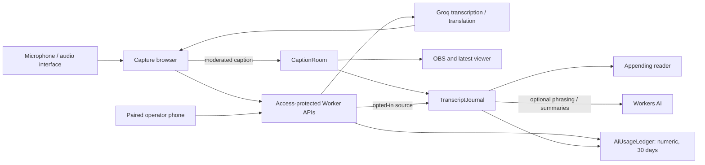

# Caption Studio

Cloud-hosted live transcription and translation for sessions such as church services.
An operator captures speech in a browser; moderated captions appear in OBS, on a
latest-caption phone viewer and in an appending transcript reader, and a paired phone
can pause or clear them. It currently runs on free-tier Groq and Cloudflare Workers AI
quotas — see [ADR 0002](docs/decisions/0002-free-cloud-first-ai.md).

- **Running a session?** Start with [Quick start for operators](#quick-start-for-operators).
- **Working on the code?** See [For contributors](#for-contributors) and
  [Contributing](CONTRIBUTING.md).

**Contents:** [Quick start](#quick-start-for-operators) ·
[What it does](#what-it-does) · [Languages, quality and AI limits](#languages-quality-and-ai-limits) ·
[Session data and lifecycle](#session-data-and-lifecycle) ·
[Not yet implemented](#not-yet-implemented) · [For contributors](#for-contributors) ·
[Architecture](#architecture) · [Documentation and status](#documentation-and-status)

## Quick start for operators

The app runs behind Cloudflare Access: ask whoever manages your team's Access policy to
add your account, then open the deployed URL (`/`) and sign in. Audience links
(`/overlay`, `/view`, `/read`) are separate, token-scoped URLs generated per session and
shared directly — they don't need Access or a sign-in.

| Surface | Purpose |
| --- | --- |
| `/` | Operator dashboard: setup, live controls, transcripts, usage |
| `/operator/mobile` | Paired Pause/Resume/Clear remote (Access-protected) |
| `/overlay` | Reusable OBS Browser Source |
| `/view` | Per-session latest-caption viewer link |
| `/read` | Per-session appending reader link |

The Live screen's readiness checklist walks you through first-time setup; each **Fix** or
**Set up** button opens the matching Settings section. **Help** (the **?** button in the
top bar) lists the steps of a session in order.

1. **Settings › OBS & links** — create the OBS link once and paste it into a
   1920 × 1080 OBS Browser Source on the OBS computer.
2. **Settings › System** — choose the microphone or audio interface, check the level and
   play the test clip back.
3. **Settings › Presets** (optional) — choose a workspace format and press
   **Apply preset**, or import a setup file with **Share setup**.
4. **Settings › Language**, **Translation** and **Terms** — choose the spoken and caption
   languages and the caption wait time, and add names, terms or words never to show.
5. **Settings › Output** — style the captions.
6. **Live** — tick **Save the transcript for 7 days** if wanted, press
   **Start captions** and check a test phrase reaches OBS. Then use **Share** for the
   phone viewer and transcript reader links and **Pair phone**. Pause, Clear screen and
   End session stay in the bar at the bottom of the screen.

## What it does

- **Transcription**: Groq Whisper transcribes the chosen microphone in 6-, 10- or
  14-second windows, or Dynamic windows that can end early at a pause or sentence end,
  using your Terms as name hints.
- **Translation**: GPT-OSS 20B translates within fixed safety rules and your approved
  terminology. Settings control how literal it is, filler removal and inappropriate-language
  filtering.
- **Terms**: one list teaches names, fixes mishearings, sets preferred translations, and
  hides or replaces words on screen.
- **Live delivery**: captions reach OBS, the phone viewer and the reader, with an
  optional 1–5 second output buffer to pause, edit or clear the next caption. During a
  session, **Quick fixes** adds a **Live note** for the translator, a quick override for
  unexpected words, and a typed message while paused.
- **Operator dashboard**: **Live**, **Transcripts**, **Settings** and **Help** screens for
  volunteers, in English or Bahasa Indonesia (the Indonesian copy awaits native review,
  [ADR 0030](docs/decisions/0030-operator-interface-localization.md)).
- **Shared workspace setup**: settings are saved once for every operator; only light/dark
  is personal ([ADR 0022](docs/decisions/0022-shared-church-setup-and-words-list.md)).
- **Presets**: **General**, **Sermon**, **Talkshow** and **Keynote** formats add context
  to the AI, and a workspace can keep custom presets up to its plan's limit
  ([ADR 0035](docs/decisions/0035-workspace-presets.md),
  [ADR 0036](docs/decisions/0036-custom-presets-and-plan-limits.md)).
- **Session history** (optional): private transcripts with corrections, exclusions and
  AI summaries, kept seven days after the session ends.

Full behavior, settings and screen layouts: [Product specification](docs/PRODUCT_SPEC.md),
[Brand guidelines](docs/BRAND_GUIDELINES.md) and [Design system](docs/DESIGN_SYSTEM.md).

## Languages, quality and AI limits

Selectable source/target languages: English, Indonesian, Japanese, Korean, Tagalog,
Simplified Chinese, Traditional Chinese and Vietnamese (Chinese assumes Mandarin).
Availability is not quality certification — evaluation is ongoing; see the
[ID→EN review](docs/evaluation/ID_EN_REVIEW.md), [remaining gaps](docs/GAP_ANALYSIS.md)
and [rehearsal gates](docs/STAKEHOLDER_TEST_GUIDE.md).

- A session lasts at most 90 minutes, including paused time, with up to 1,800
  transcription attempts and 1,800 translations. Silent or same-language chunks skip
  translation.
- Optional reader and summary AI allows at most 200 and 60 calls per session, within a
  conservative daily cap of 9,000 estimated Workers AI neurons for this app.
- There is no automatic paid fallback. Other apps may share the provider accounts, so
  provider dashboards remain authoritative.
- Live's **Technical details** shows the current session's counters; **Settings › Usage**
  shows provider headroom and a rolling **Last 30 days** of numeric usage (no transcript
  text). Clear, End and deleting a transcript don't reset usage or quotas.

Optional Workers AI (reader phrasing and summaries) is enabled only when
`CAPTION_OPTIONAL_AI_ENABLED` is exactly `true`. Keep it off until the account plan,
content handling, models and quality checks are approved
([ADR 0011](docs/decisions/0011-service-history-and-optional-inference.md)).
Admission and metering rules: [Architecture](docs/ARCHITECTURE.md#models-prompting-and-bounds).

## Session data and lifecycle

Transcript saving is off by default, is chosen before Start and can't change
mid-session. When on, the private history keeps the recognized source, corrections,
reader paragraphs and summary drafts for seven days after End, shared by every
signed-in operator. Optional **Session details** are record-only and never reach a model
([ADR 0024](docs/decisions/0024-session-metadata.md)). After End, an operator can correct
the source, remove passages, export JSON or generate a summary that cites its transcript
passages; one can also be drafted automatically after each session
([ADR 0019](docs/decisions/0019-automatic-post-service-summary.md)).

How each action affects every surface:

| Action | OBS and latest viewer | Appending reader | Private history and usage |
| --- | --- | --- | --- |
| Clear screen | Blank; capture continues | Keep committed paragraphs, discard pending work | Preserved |
| Quick override (**Hide the whole caption**) | Hides any caption containing it immediately, without a settings refresh | Same caption hidden in the reader/archive too | Preserved |
| Pause | Blank; capture stops | Keep committed paragraphs, mark boundary | Preserved |
| Manual caption (**Show your own message**, while paused) | Show operator-typed text (240 characters max) in place of the hidden translation | Not appended to paragraphs; recorded as a separate operator note | Note saved if history saving is on |
| Resume | New capture after acknowledgement | Append new paragraphs | Same session |
| Refresh translation settings (**Apply now**) | Clear and reject old results; keep session/links | Preserve earlier text; separate later revisions/languages | Preserved |
| End or 90-minute expiry | Blank; latest-viewer link revoked; OBS URL retained | Bounded finalization, then 30-minute reading grace | Saved content expires seven days later; usage keeps its own expiry |
| Takeover | Replace controller and latest-viewer link | Revoke previous reader and remote | Prior saved session retained until expiry |
| Remove passage | Clear current caption if its source belongs to the removed passage | Remove selected paragraph on refresh/poll | Preserve original source, exclude its IDs from summaries, invalidate drafts |
| Delete transcript | Available after End | Revoke reader and remove history on its next successful poll | Delete transcript content; numeric usage retained |

More detail: [Product specification](docs/PRODUCT_SPEC.md#after-the-session) and
[Security](SECURITY.md).

## Not yet implemented

Application audio storage, a paid AI fallback, simultaneous target languages, live
correction of captions already shown, tenant roles, an authorized source-text passage
corpus, and a native app (the deferred iOS shell was removed in
[ADR 0020](docs/decisions/0020-remove-ios-shell.md)). See the [Roadmap](docs/ROADMAP.md)
and [remaining gaps](docs/GAP_ANALYSIS.md).

## For contributors

Use Node.js 22.12 or newer and npm:

```sh
npm ci
cp .env.example .env.local
npm run dev
```

`.env.example` lists every variable the app reads. Keep real values in ignored local
files or encrypted Worker secrets; `CAPTION_LOCAL_AUTH_BYPASS` is for local runs only and
must never be deployed.

```sh
npm run validate     # ADR numbering, tests, strict TypeScript, ESLint, both builds, deploy dry run, diff check
npm audit --omit=dev
npm audit
npm run qa           # mocked browser, overflow and Axe checks; run for any UI change
npm run qa:runtime   # real local Durable Objects on an isolated Wrangler preview, AI disabled
```

`npm run dev` serves only the Next routes; it doesn't exercise `custom-worker.ts` or the
Durable Objects, which is what `qa:runtime` is for. QA options (port, screenshots, dark
mode, microphone stub) and the branch, PR and review workflow are in
[Contributing](CONTRIBUTING.md); commands, bindings, secrets and Access paths are in the
[deployment runbook](docs/DEPLOYMENT.md). Keep credentials and session content out of
logs, screenshots, chat and issues.

## Architecture



`custom-worker.ts` is the deployed entry: it serves the live and audience routes before
OpenNext and exports the Durable Objects. Cloudflare Workers Builds deploys `main`
directly; there is no GitHub Actions workflow and preview-branch builds are off. See
[Architecture](docs/ARCHITECTURE.md) and [Deployment](docs/DEPLOYMENT.md).

## Documentation and status

The [documentation index](docs/README.md) separates current guides, decisions and dated
evidence. Start with the maintained guides:

- [Product specification](docs/PRODUCT_SPEC.md) and [Architecture](docs/ARCHITECTURE.md)
- [Deployment](docs/DEPLOYMENT.md) and [Security](SECURITY.md)
- [Contributing](CONTRIBUTING.md), [Brand guidelines](docs/BRAND_GUIDELINES.md) and
  [Design system](docs/DESIGN_SYSTEM.md)
- [Roadmap](docs/ROADMAP.md) and [remaining gaps](docs/GAP_ANALYSIS.md)

**Status:** a pre-pilot prototype. Workers Builds deploys `main` to production; recorded
deployments and the remaining rehearsal gates are in the
[deployment runbook](docs/DEPLOYMENT.md).

This document was reviewed 5 November 2026 against merged
[PR #116](https://github.com/variable-hq/caption-studio/pull/116) (`46a13e4`).

The repository is private and has no open-source license. Third-party adaptations retain
their [notices](THIRD_PARTY_NOTICES.md).
