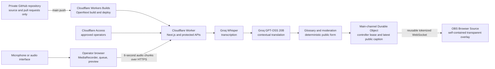

# Church Live Caption

Cloud-hosted, near-live transcription and translation for church services, with a
configurable OBS Browser Source overlay.

## Status

The current codebase implements the Phase 1 cloud prototype:

- browser microphone and audio-interface selection with an input meter;
- six-second audio chunks sent to protected, same-origin APIs;
- Groq Whisper transcription and contextual Groq translation;
- biblical and church vocabulary hints plus preferred translations;
- deterministic public-caption word masking;
- source and public-caption previews;
- 10–72px caption size, font, colour, per-line highlight, transparency, and
  horizontal or vertical alignment;
- 0–20% horizontal and vertical OBS safe margins;
- shared Main-channel style plus a browser-local fallback preference;
- minimal monochrome operator shell with guided two-column Setup and a compact Live
  layout, with appearance controls beside the live-updating caption preview;
- Start, Pause/Resume, Clear, idle-or-paused synthetic test, confirmed End, and
  confirmed takeover controls;
- active-service time and transcription-request usage indicators; and
- one reusable, explicitly rotatable OBS URL backed by a Durable Object WebSocket.

Audio and AI inference do not run on the operator's Mac beyond browser capture.
The app does not yet store sermons, generate summaries, support manual correction,
or aggregate usage across services and provider accounts. Those are later phases that require
retention, consent, review, and cost decisions.

The 20 July 2026 production smoke test passed the original microphone-to-cloud-to-OBS
journey and Access boundaries. The reusable Main-channel implementation and current
operator layout have separate automated and browser-level evidence; their deployed
Durable Object, shared-link, takeover, and real-OBS checks remain rollout gates. This is
evidence for a controlled stakeholder test, not production approval or a language-quality
sign-off. See the [validation report](docs/VALIDATION_REPORT.md) and follow the
[stakeholder test guide](docs/STAKEHOLDER_TEST_GUIDE.md).

## High-level architecture



GitHub stores and reviews the source code but does not build or deploy it. The repository
intentionally has no GitHub Actions workflow. A push to `main` is consumed by the
connected Cloudflare Workers build, which owns the production OpenNext build and deploy.

Cloudflare Access protects the dashboard, inference APIs, and operator channel APIs.
The two OBS paths bypass interactive Access because OBS cannot sign in; the Worker
instead requires the Main channel's random bearer token before opening the read-only
WebSocket. The token stays in a URL fragment, is encrypted for protected collaborator
recovery, and is passed as a WebSocket subprotocol rather than in the page request or
query string. A separate short-lived controller credential protects live mutations.

See [Architecture](docs/ARCHITECTURE.md) for trust boundaries and failure behavior,
[Product specification](docs/PRODUCT_SPEC.md) for implemented and deferred scope,
and [Roadmap](docs/ROADMAP.md) for the next phases. Stakeholder testers should start
with the [controlled test guide](docs/STAKEHOLDER_TEST_GUIDE.md).

## Supported languages

Every listed language can be selected as the spoken source or translation target:

- English
- Indonesian
- Japanese
- Korean (`ko-KR`; “South Korean” is not a separate language)
- Tagalog
- Chinese (Simplified)
- Chinese (Traditional)
- Vietnamese

Simplified and Traditional Chinese share the same Chinese speech-recognition code;
the selected script is enforced in translated output. The prototype assumes Mandarin,
not Cantonese. Explicit source selection is recommended for a live service, although
automatic detection is available.

## Biblical terminology

The prototype does not train a custom theological model. It uses bounded prompts and
operator-provided glossary mappings to preserve biblical names, Bible books, verse
references, church names, and preferred translations. The translation prompt forbids
inventing scripture, doctrine, facts, or meaning that the speaker did not provide.

This guidance improves consistency but is not theological authority. Important terms
still require church-approved testing and human oversight.

## Local development

Local development is for building and testing the web app; deployed inference remains
cloud-hosted. Requirements: Node.js 20.9 or newer and npm.

```bash
npm install
cp .env.example .env.local
npm run dev
```

Open `http://localhost:3000`. This validates the dashboard and Next.js AI routes, but the
custom live-channel routes and internal Durable Object cannot run end to end through the
current OpenNext local preview. Use a protected Cloudflare test deployment for channel
and OBS integration tests. Production must have Cloudflare Access configured; never set
the Worker's local authentication bypass in a deployed environment.

Available checks:

```bash
npm test
npm run typecheck
npx tsc --noEmit --noUnusedLocals --noUnusedParameters
npm run lint
npm run build
npx opennextjs-cloudflare build
npm audit
git diff --check
npm run preview
```

There is no GitHub Actions fallback. Contributors must run the relevant checks locally
before review; a successful Cloudflare deployment is not a substitute for those checks.

For operator-layout or caption-style changes, also verify a 1200px desktop viewport and
a 390px mobile viewport in a real browser. Confirm that the preview responds while each
appearance control is being adjusted, controls remain reachable, and neither viewport
has horizontal overflow.

The monochrome theme applies only to the operator console. Caption text, highlight,
transparency, and OBS placement remain independently configurable for the stream output.

`npm run preview` still verifies the OpenNext/Worker bundle and non-Durable-Object routes.
Wrangler is expected to warn that this internal Durable Object is unavailable locally.

After changing Cloudflare bindings, regenerate their types:

```bash
npm run cf-typegen
```

## Cloud configuration

Required deployment configuration:

| Name | Type | Purpose |
| --- | --- | --- |
| `GROQ_API_KEY` | encrypted Worker secret | Server-side Groq authentication |
| `OBS_CHANNEL_ENCRYPTION_KEY` | encrypted Worker secret | Encrypts the recoverable reusable OBS token; minimum 32 random characters |
| `CLOUDFLARE_ACCESS_AUD` | Worker variable | Expected Access application audience |
| `CLOUDFLARE_ACCESS_TEAM_DOMAIN` | Worker variable | Access team domain used for JWT verification |
| `GROQ_TRANSCRIPTION_MODEL` | optional Worker variable | Override `whisper-large-v3-turbo` |
| `GROQ_TRANSLATION_MODEL` | optional Worker variable | Override `openai/gpt-oss-20b`; the retired `llama-3.1-8b-instant` value is ignored |

Never expose either secret through a `NEXT_PUBLIC_` variable, commit it, paste it into
an issue, or include it in screenshots. `wrangler.jsonc` declares the SQLite-backed
`CAPTION_ROOMS` Durable Object and retains dashboard-managed variables during deploy.

## Deployment checklist

1. Keep the Cloudflare account and Worker on the Free plan if zero spend is required.
2. Add `GROQ_API_KEY` with `wrangler secret put GROQ_API_KEY` or the encrypted dashboard
   secret control.
3. Add `OBS_CHANNEL_ENCRYPTION_KEY` with at least 32 random characters before creating
   the Main channel. Do not change it casually; rotate the OBS link if it is lost.
4. Enable Groq Zero Data Retention before any approved real-sermon test.
5. Add the Access audience and team-domain variables.
6. Protect the dashboard, `/api/ai/*`, and `/api/live/channel*` with an approved-operator
   Cloudflare Access policy.
7. Add more-specific Access bypass applications for `/overlay*` and
   `/api/live/overlay*`; these routes have no AI capability and enforce the channel token.
8. Confirm the Cloudflare Workers build is connected to this repository and targets
   `main`. Merge the reviewed change and verify that Cloudflare reports a successful
   build and deployment. Owners may use `npm run deploy` only as a deliberate manual
   recovery path.
9. Verify the deployed revision, dashboard Access, provider readiness, Main-channel
   creation/retrieval, idle test/clear, End-with-URL-retention, takeover, and explicit
   rotation without copying the bearer URL into logs or evidence.

## OBS Browser Source

1. Sign in, complete Setup, and select **Create OBS channel** once.
2. Copy the reusable Main channel URL into a 1920 × 1080 OBS Browser Source.
3. Select **Show test** while idle to verify the transparent overlay, style, alignment,
   and safe margins without microphone capture or a Groq request; then clear OBS.
4. Start captions. Pause stops microphone capture and Groq calls while keeping the URL
   and original 90-minute service expiry. Resume clears synthetic text before capture.
5. End the service after confirming. End clears OBS and releases operator control but
   deliberately keeps the same Browser Source URL for the next service.
6. Use **Rotate OBS link** only if the bearer URL was exposed. Rotation immediately
   invalidates the old source and requires replacing its URL in OBS.

Anyone holding the URL can read public captions whenever the Main channel publishes
them. Treat it as a long-lived bearer credential: do not publish, log, or show it in
screenshots. The URL does not expire automatically; each active service still stops at
90 minutes.

The UI's latency value is cloud **processing** time after a six-second recording chunk
has completed. Approximate spoken-to-screen time is therefore six seconds plus the
displayed processing time and normal browser/network rendering delay.

## Free-plan guardrails

The app enforces a 90-minute service, six-second transcription chunks, one target
language, a bounded two-chunk queue, bounded prompt and request sizes, and no automatic
paid-provider fallback. A Groq `429` ends the service rather than purchasing capacity.
Pause, Clear, Resume, and Show test caption use only low-volume Worker/Durable Object
requests. The synthetic test caption does not call Groq.

Before each transcription attempt, the client atomically reserves one of the service's
900 requests while validating its short-lived controller lease in the Main Durable
Object. This counter survives reloads and takeovers. The extra small Cloudflare request
also prevents a replaced operator from continuing Groq usage.

These controls cannot guarantee account-wide free usage: Groq limits apply to the
organization and Cloudflare limits apply to the account, while the UI meter covers this
application's current Main-channel service. Other applications share those limits. Keep
both accounts on their Free plans and check their provider dashboards before a service.
GPT-OSS 20B currently has a lower daily token allowance than the previous model, so a
content-heavy service can still stop on a provider `429` before the 900-request ceiling.
Current limits are authoritative in the
[Groq rate-limit documentation](https://console.groq.com/docs/rate-limits) and
[Cloudflare Workers pricing](https://developers.cloudflare.com/workers/platform/pricing/).
The prototype has no production SLA; exhaustion stops captions.

## Data handling and safeguards

- The app sends short-lived audio chunks to Groq and does not store audio.
- The Main Durable Object keeps constant-size channel configuration: encrypted OBS
  token, token hash, shared style, controller hash while active, sequence, timestamps,
  and at most the latest moderated public caption.
- Protected source captions remain in browser memory only during the active service.
- Saved display preferences use browser `localStorage`; glossary and filter text do not.
- The usage indicator is browser-service telemetry, not billing or account metering.
- Groq ZDR is required for real-sermon testing. Groq still retains non-content usage
  metadata under its published data policy.
- Bible text must not be imported without permission for the chosen translation.
- AI summaries and archives remain disabled until consent, retention, access control,
  deletion, grounding, and human-review behavior are implemented.

Read [SECURITY.md](SECURITY.md) before deployment and [CONTRIBUTING.md](CONTRIBUTING.md)
before changing the project.

## License

This private repository intentionally has no open-source license. Copyright remains
with the contributors unless the project owners adopt a license in a recorded decision.
