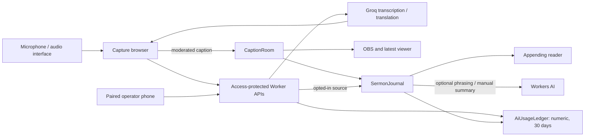

# Caption Studio

Cloud-hosted transcription and translation for church services, with fast OBS captions,
a latest-caption phone viewer, an appending reader, and a paired operator remote.
Currently built on free-tier Groq and Cloudflare Workers AI quotas — see
[ADR 0002](docs/decisions/0002-free-cloud-first-ai.md).

- [Overview](#overview)
- [Get Started](#get-started)
- [Languages and quality](#languages-and-quality)
- [Core Features](#core-features)
- [Not yet implemented](#not-yet-implemented)
- [AI usage and limits](#ai-usage-and-limits)
- [Architecture](#architecture)
- [Development and QA](#development-and-qa)
- [Documentation](#documentation)
- [Project status](#project-status)

## Overview

- **Capture and transcription**: browser-based microphone selection with a level meter, a
  first-run readiness checklist, and a 6- to 18-second recording window transcribed by Groq
  Whisper with bounded biblical/church-name hints and approved recognition aliases.
- **Translation**: GPT-OSS 20B translates through an immutable safety envelope, approved
  terminology, and an operator-selectable **Inference Level** (Low/Balanced/High) governing
  how literally vs. coherently it translates. One **Words** list teaches names, fixes
  mishearings, sets preferred translations and masks, replaces or hides words on screen.
- **Live delivery**: moderated captions reach a reusable OBS Browser Source, a per-service
  mobile viewer, and an appending reader, with an instant quick-block for unanticipated
  words and an optional pre-publish output buffer (wait 1–5 seconds; pause, edit, clear,
  or fast-forward the next-up caption).
- **Operator dashboard**: three screens, **Live**, **Sermons** and **Settings**, built
  for volunteers. Live shows what was heard beside what the audience sees, a readiness
  checklist that links to each fix, and, during a service, Pause, Clear screen and End
  service pinned to the bottom of the screen. Every screen has its own bookmarkable
  address. Full behavior and visuals: [Product specification](docs/PRODUCT_SPEC.md),
  [Brand guidelines](docs/BRAND_GUIDELINES.md) and [Design system](docs/DESIGN_SYSTEM.md).
- **One church setup**: languages, words, translator instructions, caption style, summary
  defaults and the output buffer are saved once for every operator; only the light/dark
  choice is personal ([ADR 0022](docs/decisions/0022-shared-church-setup-and-words-list.md)).
- **Service history**: optional workspace-wide private archives, corrections, exclusions,
  and AI-generated summaries, retained seven days after End.

## Get Started

- **For operators** running a live service: sign-in and surface details are right
  below, followed by the six-step setup guide.
- **For contributors** working on the codebase: skip to
  [Development and QA](#development-and-qa) for local setup and validation, and
  [Contributing](CONTRIBUTING.md) for the branch/PR workflow.

The app runs behind Cloudflare Access: ask whoever manages your team's Access policy to
add your account, then open the deployed URL (`/`) and sign in to reach the operator
dashboard. Audience-facing links (`/overlay`, `/view`, `/read`) are separate,
token-scoped URLs generated per service and shared directly — they don't need Access or
a sign-in.

| Surface | Purpose |
| --- | --- |
| `/` | Capture computer: setup, live controls, archives, usage |
| `/operator/mobile` | Paired Pause/Resume/Clear remote (Access-protected) |
| `/overlay` | Reusable OBS Browser Source |
| `/view` | Per-service latest-caption viewer link |
| `/read` | Per-service appending reader link |

First-time setup follows the Live screen's checklist; the **Help** page (the **?** button)
lists the same steps:

1. **Settings › OBS & links** — create the OBS link once and paste it into a 1920 × 1080
   OBS Browser Source on the separate OBS computer.
2. **Settings › This computer** — choose the microphone or audio interface and check the
   level.
3. **Settings › Languages & timing** and **Words** — choose the spoken and caption
   languages, caption speed, names and terms, and words never to show.
4. **Settings › Caption look** — style the captions.
5. **Live** — tick whether to save the transcript, press **Start captions**, check a test
   phrase reaches OBS, then share the phone viewer and reader links and pair a phone as a
   remote. Pause, Clear screen and End service stay at the bottom of the screen.

## Languages and quality

Selectable source/target languages: English, Indonesian, Japanese, Korean, Tagalog,
Simplified Chinese, Traditional Chinese, and Vietnamese (Chinese assumes Mandarin).
Availability is not quality certification — evaluation is ongoing; see the
[ID→EN review](docs/evaluation/ID_EN_REVIEW.md), [remaining gaps](docs/GAP_ANALYSIS.md),
and [rehearsal gates](docs/STAKEHOLDER_TEST_GUIDE.md).

## Core Features

**Live captioning.** Moderated captions publish to a reusable OBS Browser Source, a
per-service mobile viewer, and an appending reader, with an optional output buffer
holding the next caption for 1–5 seconds before it
publishes — Pause, refresh, takeover, or End discard it; Clear screen leaves it
queued. See [ADR 0016](docs/decisions/0016-client-side-output-buffer.md) and
[ADR 0017](docs/decisions/0017-configurable-output-buffer-dwell.md).

**Appending reader.** Batches up to five moderated translation chunks about every 30
seconds. With optional AI enabled it can improve punctuation/phrasing before reapplying
glossary/filter rules; with it disabled, chunks join as-is. More phones don't create
more model calls. Manual captions shown while paused appear here too, as separate
operator notes alongside the translated paragraphs.

**Paired operator remote.** `/operator/mobile` offers a Pause/Resume/Clear remote; the
microphone always stays on the capture computer, and actions report as confirmed only
after it acknowledges them. Server-side Pause blocks new inference immediately; Resume
requires the capture computer to still be connected.

**Live settings and drafts.** Language, vocabulary, filters, recording window,
inference level, and prompt edits stay drafts until a confirmed translation refresh,
which preserves the service clock, controller, links, and usage. OBS link rotation is
a separate idle action.

**Service history.** History saving is off by default, must be enabled before Start,
and can't change mid-service. When on, the private journal keeps recognized source,
corrections, reader paragraphs, and summary drafts for seven days after End, shared by
every signed-in operator. After End, an operator can correct source, remove passages,
export the transcript as JSON, or generate a summary (requires optional Workers AI,
grounded to approved church content). Full behavior:
[Product specification](docs/PRODUCT_SPEC.md#after-the-service).

| Action | OBS and latest viewer | Appending reader | Private history and usage |
| --- | --- | --- | --- |
| Clear screen | Blank; capture continues | Keep committed paragraphs, discard pending work | Preserved |
| Quick block a word | Hides any caption containing it immediately, without a settings refresh | Same caption hidden in the reader/archive too | Preserved |
| Pause | Blank; capture stops | Keep committed paragraphs, mark boundary | Preserved |
| Manual caption (while paused) | Show operator-typed text (240 characters max) in place of the hidden translation | Not appended to paragraphs; recorded as a separate operator note | Note saved if history saving is on |
| Resume | New capture after acknowledgement | Append new paragraphs | Same service |
| Refresh translation settings | Clear and reject old results; keep service/links | Preserve earlier text; separate later revisions/languages | Preserved |
| End or 90-minute expiry | Blank; latest-viewer link revoked; OBS URL retained | Bounded finalization, then 30-minute reading grace | Saved content expires seven days later; usage keeps its own expiry |
| Takeover | Replace controller and latest-viewer link | Revoke previous reader and remote | Prior saved service retained until expiry |
| Remove passage | Clear current caption if its source belongs to the removed passage | Remove selected paragraph on refresh/poll | Preserve original source, exclude its IDs from summaries, invalidate drafts |
| Delete sermon | Available after End | Revoke reader and remove history on its next successful poll | Delete sermon content; numeric usage retained |

Use **Live** for the phone viewer, reader link and phone pairing during a service;
**Settings › OBS & links** for the OBS link and replacing links; **Sermons** for private
archives and summaries; and **Settings › Usage** for rolling usage history.

## Not yet implemented

Application audio storage, a paid AI fallback, simultaneous target languages, a live
caption correction editor, shared church profiles, tenant roles, an authorized TB2
passage corpus, and a native app (the deferred iOS shell was removed in
[ADR 0020](docs/decisions/0020-remove-ios-shell.md)). See
[Roadmap](docs/ROADMAP.md) and [remaining gaps](docs/GAP_ANALYSIS.md) for planned work.

## AI usage and limits

The protected dashboard separates service counters from **Last 30 days** usage across
this deployment. Numeric rows record provider, model, stage, service, time, known
tokens/audio, and unknown outcomes; no sermon text or credentials. Each expires 30 days
after its original attempt. Clear, End, takeover and archive deletion do not reset usage
or provider quotas. This is a rolling window, not a calendar month or renewed allowance.

- Services last at most 90 minutes, including paused time, with 900 reserved transcription
  attempts and at most 900 fast translations. Silent/same-language chunks skip translation.
- Inference requires Access, the current controller, and a one-time reserved attempt per
  stage. Requests carry `x-caption-controller` and `x-caption-transcription-attempt`.
- Provider dispatch requires persisted usage admission. Duplicate/uncertain attempts are
  not automatically replayed. Unknown consumption remains unknown.
- Optional reader/summary work allows at most 200/60 calls per service. Conservative
  daily reservations cap this app at 9,000 estimated neurons, including a 6,000 reader cap.
- Capacity estimates use stated limits. Other apps may consume account quotas; provider
  dashboards remain authoritative. There is no automatic paid fallback.

`CAPTION_OPTIONAL_AI_ENABLED` must be exactly `true` to enable Workers AI. Keep it
off until account plan, content handling, models, and approved quality checks are verified.
See [ADR 0011](docs/decisions/0011-service-history-and-optional-inference.md).

## Architecture



`custom-worker.ts` dispatches live/experience routes before OpenNext and exports all
four SQLite Durable Objects. `wrangler.jsonc` declares `CAPTION_ROOMS`,
`SERMON_JOURNALS`, `AI_USAGE`, `OPERATOR_PREFERENCES`, `AI`, and `ASSETS` plus v1/v2/v3
migrations.
GitHub provides source review; Cloudflare Workers Builds publishes merges to `main`.
There is no GitHub Actions workflow. See [Architecture](docs/ARCHITECTURE.md).

## Development and QA

Use Node.js 22.12 or newer and npm:

```sh
npm ci
cp .env.example .env.local
npm run dev
```

Keep real values in ignored local files or encrypted Worker secrets. `.env.example`
lists every variable the application reads; `CAPTION_LOCAL_AUTH_BYPASS` is for local
runs only and must never be deployed. The QA scripts additionally read
`CAPTION_QA_TOOLS_DIR` and `CAPTION_QA_ORIGIN`. Next dev alone does not prove the Cloudflare lifecycle. For local Worker checks without remote AI, follow
[isolated runtime QA](docs/LIVE_SESSION_PLAN_1_QA.md#runtime-rehearsal).
Standard `npm run preview` uses OpenNext's remote AI proxy and needs Cloudflare
credentials plus Access service authentication when its preview domain is protected.

```sh
npm run validate
npm audit --omit=dev
npm audit
```

Validation checks for duplicate ADR numbers, then runs tests with one worker, strict
TypeScript, ESLint, both production builds, and a non-publishing deployment dry run,
finishing with a whitespace check, sequentially. Run
`npm run cf-typegen` after binding changes.

Browser and runtime QA scripts are separate from validation. The browser scripts load
Playwright and Axe from an isolated directory so that no test dependency enters the
product. Run `npm run qa` (or `npm run qa:all`) to install that isolated tooling and
Chromium when needed, start the local server, and run the two mocked browser suites in
sequence. Every API request is mocked:

```sh
npm run dev -- --hostname 127.0.0.1 --port 3100
# Individual scripts remain available when the server and tooling are already running.
CAPTION_QA_TOOLS_DIR=/tmp/church-caption-ui-qa npm run qa:operator
CAPTION_QA_TOOLS_DIR=/tmp/church-caption-ui-qa npm run qa:experience
```

If headless Chromium's fake microphone never resolves on your machine (the operator suite
then times out at **Start captions**), set `CAPTION_QA_STUB_MIC=1` to substitute a
synthetic tone for the microphone in the operator suite. It is off by default.

`npm run qa:runtime` exercises the real local Durable Objects against an isolated
Wrangler preview on port 8787 with AI disabled; follow
[Plan 1 QA](docs/LIVE_SESSION_PLAN_1_QA.md#runtime-rehearsal). Script output under
`test-results/` is ignored local evidence; commit only the synthetic captures a review
needs, under `docs/review-assets/`.

Use the [deployment runbook](docs/DEPLOYMENT.md) for commands, exact Access paths, secrets,
the proxy failure, and post-merge verification. Keep credentials and sermon content out
of logs, screenshots, chat and issues.

## Documentation

[Documentation index](docs/README.md) separates current specifications, decisions,
pending evaluation, and dated evidence. Start with:

- [Product specification](docs/PRODUCT_SPEC.md), [Roadmap](docs/ROADMAP.md), and
  [remaining gaps](docs/GAP_ANALYSIS.md).
- [Security](SECURITY.md) and [Contributing](CONTRIBUTING.md).
- [Plan 1 design](docs/LIVE_SESSION_FEEDBACK_PLAN_1.md) and
  [Plan 1 QA](docs/LIVE_SESSION_PLAN_1_QA.md).
- [Cleanup and deployment QA](docs/CLEANUP_DEPLOY_QA.md) and
  [export hygiene QA](docs/EXPORT_HYGIENE_QA.md).

## Project status

One successful Cloudflare deployment is on record (13 September 2026); merges since then
have no recorded build ID yet. See the [deployment runbook](docs/DEPLOYMENT.md) for
build/Worker IDs, the fix that unblocked the first deploy, and remaining rehearsal gates.

<sub>This document reviewed 2 October 2026 against merged [PR #57](https://github.com/variable-hq/caption-studio/pull/57) (`09244e8`).</sub>

The repository is private and has no open-source license. Third-party adaptations retain
their [notices](THIRD_PARTY_NOTICES.md).
