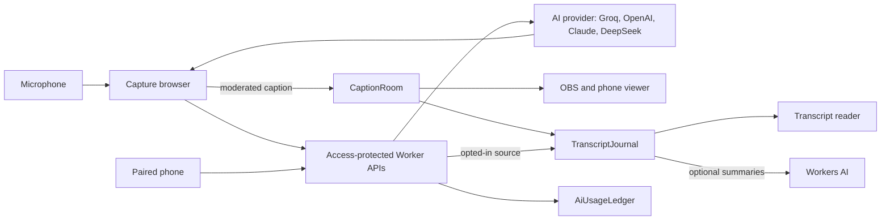

# Caption Studio

Live transcription and translation for sessions such as church services. An operator
captures speech in a browser; moderated captions go to OBS, a phone viewer and a
transcript reader.

Status: pre-pilot prototype. Private repository, no open-source license; third-party
notices in [THIRD_PARTY_NOTICES.md](THIRD_PARTY_NOTICES.md).

## Surfaces

| Path | Purpose | Access |
| --- | --- | --- |
| `/` | Operator dashboard: Live, Transcripts, Settings, Help | Cloudflare Access |
| `/operator/mobile` | Paired phone remote: Pause, Resume, Clear | Cloudflare Access + pairing |
| `/overlay` | OBS Browser Source, 1920 × 1080 | Reusable OBS token |
| `/view` | Latest caption on audience phones | Per-session token |
| `/read` | Appending transcript reader | Per-session token |

## Operator setup

1. **Settings › OBS & links**: copy the OBS link into a 1920 × 1080 Browser Source.
2. **Settings › System**: choose and test the microphone.
3. **Settings › Language**, **Translation**, **Terms**: languages, caption wait time, names
   and words to hide.
4. **Settings › Output**: caption style.
5. **Live**: press **Start captions**; share links from **Share**.

The Live readiness checklist links to any step still missing.

## Features

- Transcription in 6–14 second or Dynamic windows, with Terms as name hints.
- Translation within fixed safety rules and approved terminology.
- AI providers per stage: Groq by default; OpenAI for transcription; OpenAI, Claude or
  DeepSeek for translation, on encrypted workspace keys
  ([ADR 0041](docs/decisions/0041-workspace-ai-providers.md)).
- Optional 1–5 second output buffer to edit, pause or skip the next caption.
- Workspace formats (General, Sermon, Talkshow, Keynote) and custom presets.
- Optional saved transcripts with corrections and AI summaries, kept 7 days.
- Operator interface in English or Bahasa Indonesia.

Languages: English, Indonesian, Japanese, Korean, Tagalog, Simplified and Traditional
Chinese, Vietnamese. Listed languages are not quality-certified.

## Limits

- 90 minutes per session, including pauses; 1,800 transcription and 1,800 translation
  attempts.
- Transcript saving is off by default and fixed at Start.
- No audio is stored. Usage records hold numbers only and expire after 30 days.
- No automatic paid fallback: a provider failure stops captions.

## Development

Node.js 22.12 or newer.

```sh
npm ci
cp .env.example .env.local
npm run dev          # Next routes only; no Worker or Durable Objects
npm run validate     # ADRs, tests, types, lint, both builds, deploy dry run
npm run qa           # browser, overflow and Axe checks; required for UI changes
npm run qa:runtime   # local Worker and Durable Objects
```

Branch from `develop` and open pull requests into `develop`. `main` receives only
release pull requests and is the only branch Cloudflare deploys. See
[CONTRIBUTING.md](CONTRIBUTING.md).

## Architecture



`custom-worker.ts` is the deployed entry and exports the Durable Objects.

## Documentation

- [Documentation index](docs/README.md)
- [Product specification](docs/PRODUCT_SPEC.md) · [Architecture](docs/ARCHITECTURE.md)
- [Deployment](docs/DEPLOYMENT.md) · [Security](SECURITY.md)
- [Contributing](CONTRIBUTING.md) · [Brand guidelines](docs/BRAND_GUIDELINES.md) ·
  [Design system](docs/DESIGN_SYSTEM.md)
- [Roadmap](docs/ROADMAP.md) · [Known gaps](docs/GAP_ANALYSIS.md)

Reviewed 9 November 2026 against merged PR #123 (`4afb3e5`).
