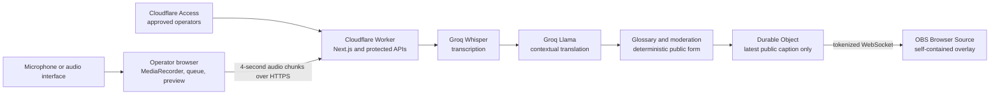

# Church Live Caption

Cloud-hosted, near-live transcription and translation for church services, with a
configurable OBS Browser Source overlay.

## Status

The current codebase implements the Phase 1 cloud prototype:

- browser microphone and audio-interface selection with an input meter;
- four-second audio chunks sent to protected, same-origin APIs;
- Groq Whisper transcription and contextual Groq translation;
- biblical and church vocabulary hints plus preferred translations;
- deterministic public-caption word masking;
- source and public-caption previews;
- 10–72px caption size, font, colour, per-line highlight, transparency, and
  horizontal or vertical alignment;
- browser-local saved display preferences;
- active-session time and transcription-request usage indicators; and
- an expiring, revocable OBS URL backed by a Durable Object WebSocket.

Audio and AI inference do not run on the operator's Mac beyond browser capture.
The app does not yet store sermons, generate summaries, support manual correction,
or track usage across browsers or sessions. Those are later phases that require
retention, consent, review, and cost decisions.

A production smoke test on 20 July 2026 passed the core microphone-to-cloud-to-OBS
journey, Access boundaries, live style propagation, reconnect, and session revocation.
This is evidence for a controlled stakeholder test, not production approval or a
language-quality sign-off. See the [validation report](docs/VALIDATION_REPORT.md) and
follow the [stakeholder test guide](docs/STAKEHOLDER_TEST_GUIDE.md).

## High-level architecture



Cloudflare Access protects the dashboard, inference APIs, and operator session APIs.
The two OBS paths bypass interactive Access because OBS cannot sign in; the Worker
instead requires a random session token before opening the read-only WebSocket. The
token is created in a URL fragment and then passed as a WebSocket subprotocol, so it
is not sent in the initial page request or a query string.

See [Architecture](docs/ARCHITECTURE.md) for trust boundaries and failure behavior,
[Product specification](docs/PRODUCT_SPEC.md) for implemented and deferred scope,
and [Roadmap](docs/ROADMAP.md) for the next phases. Stakeholder testers should start
with the [controlled test guide](docs/STAKEHOLDER_TEST_GUIDE.md).

## Supported languages

Every listed language can be selected as the spoken source or translation target:

- English
- Indonesian
- Japanese
- Korean (`ko-KR`; “South Korean” is not a separate language)
- Tagalog
- Chinese (Simplified)
- Chinese (Traditional)
- Vietnamese

Simplified and Traditional Chinese share the same Chinese speech-recognition code;
the selected script is enforced in translated output. The prototype assumes Mandarin,
not Cantonese. Explicit source selection is recommended for a live service, although
automatic detection is available.

## Biblical terminology

The prototype does not train a custom theological model. It uses bounded prompts and
operator-provided glossary mappings to preserve biblical names, Bible books, verse
references, church names, and preferred translations. The translation prompt forbids
inventing scripture, doctrine, facts, or meaning that the speaker did not provide.

This guidance improves consistency but is not theological authority. Important terms
still require church-approved testing and human oversight.

## Local development

Local development is for building and testing the web app; deployed inference remains
cloud-hosted. Requirements: Node.js 20.9 or newer and npm.

```bash
npm install
cp .env.example .env.local
npm run dev
```

Open `http://localhost:3000`. This validates the dashboard and Next.js AI routes, but the
custom live-session routes and internal Durable Object cannot run end to end through the
current OpenNext local preview. Use a protected Cloudflare test deployment for session
and OBS integration tests. Production must have Cloudflare Access configured; never set
the Worker's local authentication bypass in a deployed environment.

Available checks:

```bash
npm test
npm run typecheck
npm run lint
npm run build
npm run preview
```

`npm run preview` still verifies the OpenNext/Worker bundle and non-Durable-Object routes.
Wrangler is expected to warn that this internal Durable Object is unavailable locally.

After changing Cloudflare bindings, regenerate their types:

```bash
npm run cf-typegen
```

## Cloud configuration

Required deployment configuration:

| Name | Type | Purpose |
| --- | --- | --- |
| `GROQ_API_KEY` | encrypted Worker secret | Server-side Groq authentication |
| `CLOUDFLARE_ACCESS_AUD` | Worker variable | Expected Access application audience |
| `CLOUDFLARE_ACCESS_TEAM_DOMAIN` | Worker variable | Access team domain used for JWT verification |
| `GROQ_TRANSCRIPTION_MODEL` | optional Worker variable | Override `whisper-large-v3-turbo` |
| `GROQ_TRANSLATION_MODEL` | optional Worker variable | Override `llama-3.1-8b-instant` |

Never expose `GROQ_API_KEY` through a `NEXT_PUBLIC_` variable, commit it, paste it into
an issue, or include it in screenshots. `wrangler.jsonc` declares the SQLite-backed
`CAPTION_ROOMS` Durable Object and retains dashboard-managed variables during deploy.

## Deployment checklist

1. Keep the Cloudflare account and Worker on the Free plan if zero spend is required.
2. Add `GROQ_API_KEY` with `wrangler secret put GROQ_API_KEY` or the encrypted dashboard
   secret control.
3. Enable Groq Zero Data Retention before any approved real-sermon test.
4. Add the Access audience and team-domain variables.
5. Protect the dashboard, `/api/ai/*`, and `/api/live/session*` with an approved-operator
   Cloudflare Access policy.
6. Add more-specific Access bypass applications for `/overlay*` and
   `/api/live/overlay*`; these routes have no AI capability and enforce the session token.
7. Deploy with `npm run deploy` or an equivalent Cloudflare Workers Build.
8. Verify the dashboard requires Access, provider readiness passes, a session can be
   ended, an expired OBS URL fails, and no secret appears in browser developer tools.

## OBS Browser Source

The application already generates the OBS URL as part of a live session:

1. Sign in to the operator dashboard and start a caption session.
2. Copy the generated Browser Source URL.
3. In OBS, add **Browser**, use a 1920 × 1080 canvas, and paste the URL.
4. Confirm the transparent overlay connects and receives a synthetic test caption.
5. End the session after the service; this revokes the link and clears the room.

Anyone holding an active URL can view that session's public captions. Treat it as a
short-lived credential: do not publish, log, or reuse it. Each link expires after at
most 90 minutes.

The UI's latency value is cloud **processing** time after a four-second recording chunk
has completed. Approximate spoken-to-screen time is therefore four seconds plus the
displayed processing time and normal browser/network rendering delay.

## Free-plan guardrails

The app enforces a 90-minute session, four-second transcription chunks, one target
language, a bounded two-chunk queue, bounded prompt and request sizes, and no automatic
paid-provider fallback. A Groq `429` ends the session rather than purchasing capacity.

These controls cannot guarantee account-wide free usage: Groq limits apply to the
organization and Cloudflare limits apply to the account, while the UI meter covers only
the current browser session. Other sessions and applications share those limits. Keep
both accounts on their Free plans and check their provider dashboards before a service.
Current limits are authoritative in the
[Groq rate-limit documentation](https://console.groq.com/docs/rate-limits) and
[Cloudflare Workers pricing](https://developers.cloudflare.com/workers/platform/pricing/).
The prototype has no production SLA; exhaustion stops captions.

## Data handling and safeguards

- The app sends short-lived audio chunks to Groq and does not store audio.
- Only the latest moderated public caption, style, token hash, and expiry are kept in
  the Durable Object for the active session.
- Protected source captions remain in browser memory only during the session.
- Saved display preferences use browser `localStorage`; glossary and filter text do not.
- The usage indicator is browser-session telemetry, not billing or account metering.
- Groq ZDR is required for real-sermon testing. Groq still retains non-content usage
  metadata under its published data policy.
- Bible text must not be imported without permission for the chosen translation.
- AI summaries and archives remain disabled until consent, retention, access control,
  deletion, grounding, and human-review behavior are implemented.

Read [SECURITY.md](SECURITY.md) before deployment and [CONTRIBUTING.md](CONTRIBUTING.md)
before changing the project.

## License

This private repository intentionally has no open-source license. Copyright remains
with the contributors unless the project owners adopt a license in a recorded decision.
