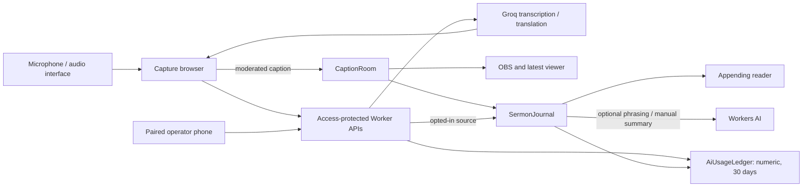

# Church Live Caption

Cloud-hosted transcription and translation for church services, with fast OBS captions,
a latest-caption phone viewer, an appending reader, and a paired operator remote.

## Status

Reviewed against merged [PR #33](https://github.com/lukaskawira/church-live-caption/pull/33) (`abae57b`), 14 September 2026. Plan 1 is implemented in
source. Its first Cloudflare deployment of `20597d8` failed after compilation; the deploy
command was corrected and the retry **deployed successfully on 13 September at 08:05 UTC**.
The four later merges (#28 docs and deploy guard, #30 dashboard navigation, #32 service
panel, #33 export hygiene) have no recorded build ID or Worker version yet. See the
[deployment runbook](docs/DEPLOYMENT.md) for the fix, commands and remaining rehearsal gates.
A 14 September [export audit](docs/EXPORT_HYGIENE_QA.md) found no orphan file or unused
dependency and removed the remaining dead exports.

The operator dashboard now opens on a service overview with grouped sidebar navigation.
On phones, the menu button (accessible name **Open navigation**) opens a drawer. Section links support bookmarks and browser
Back/Forward; switching sections does not start capture or add AI calls.
**Service controls** opens a collapsible right panel with Start, history consent and live
controls. It starts closed; Master Controls (Start/Take over, Pause/Resume, Clear, End)
stays reachable whether the panel is open or closed, each button enabled only when it
applies to the current state. Quick block and Manual caption, grouped as **Manual
overrides** alongside the output buffer's queued-caption controls, are reachable only
inside the expanded panel.
The **Output monitor**, a scaled copy of the 1920 × 1080 OBS canvas showing the caption
currently published, sits at the top of **Live outputs**; Appearance keeps a sample preview
beside its editor. **AI usage** loads the 30-day ledger of previous services on open.
The navigation rail (and the phone drawer) holds **How to use** and the **Theme** choice
(System, Light, Dark); the header keeps only **Service controls**, and the cloud and
Main-channel status pills sit in a bar docked at the bottom of the workspace. The
desktop sidebar is resizable; theme and width follow the operator's account. Styles use shared
design tokens and one control system; see the [design system](docs/DESIGN_SYSTEM.md).
Settings hold **AI instructions** (translation prompt) and **AI summary** (default
summary model, language, length and guidance). **Save to my account** stores each with
the signed-in operator; Translation offers **Save as my default setup** for languages,
recording window, inference level, terminology and filters. Discrete-choice controls with
a saved default (recording window, inference level, output buffer, languages, caption
style) mark that option "· Your default" in their own dropdown.
See the [service-panel design and QA record](docs/SERVICE_PANEL_UX_QA.md) and the
[earlier dashboard review](docs/DASHBOARD_UI_QA.md).

Implemented: browser audio selection and meter; six-step setup guide; 6- to 18-second
capture; Groq Whisper transcription and contextual GPT-OSS 20B translation; a
three-level Inference Level control (Low/Balanced/High) for translation literalness vs.
coherence; biblical name hints, approved recognition aliases, preferred translations and
configurable public filtering (mask, replace, or hide); an instant quick-block for
unanticipated words; editable translation settings; an optional output buffer (On/Off,
configurable dwell) with pause, edit, clear, and fast-forward on the next-up caption; OBS
styles and safe margins; and the service features below.

AI runs in the cloud; the browser captures audio. No application audio storage,
paid fallback, simultaneous target languages, live caption correction editor, shared
church profiles, tenant roles, or authorized TB2 passage corpus is implemented.
The [iOS experiment](ios/README.md) is deferred research under
[ADR 0003](docs/decisions/0003-defer-apple-distribution.md).

## Operator and audience surfaces

| Surface | Purpose | Extra AI from opening it |
| --- | --- | --- |
| `/` | Access-protected capture computer, setup, archives and usage | Capture invokes the live pipeline |
| `/operator/mobile` | Access-protected, paired Pause/Resume/Clear remote; microphone stays on the computer | None |
| `/overlay` | Reusable read-only OBS Browser Source, latest public caption and style | None |
| `/view` | Separate per-service link, latest moderated translation and status | None |
| `/read` | Separate service link, appending translated paragraphs and local text sizing | None per viewer; optional shared phrasing job |

The reader batches up to five moderated translation chunks about every 30 seconds.
With optional AI disabled or unavailable, it joins existing translations. With AI enabled,
it can improve punctuation and phrasing, then reapplies glossary/filter rules. More phones
do not create more model calls. Reading delay is additional to the fast caption delay.
Manual captions shown while paused appear on the reader too, as separate operator notes
alongside — not merged into — the translated paragraphs.

The remote reports microphone actions as confirmed only after the capture computer
acknowledges them. Server-side Pause blocks new inference claims immediately. Resume
requires the capture computer to be connected and able to capture.

Use **Live outputs** for OBS, the latest-caption viewer, reader links, and phone pairing,
both before and during a service; expand the destination you need. Use **Sermon history** for private archives and summaries,
and **AI usage** for service counters and rolling usage history.

## Service history, summaries, and controls

**History saving is off by default and must be enabled before Start.** The choice cannot
change during that service. With saving enabled, the private journal retains recognized
source, separate corrections/exclusions, reader paragraphs, and summary drafts for seven
days after End or expiry. Authorized operators share the app's archives; ownership is
not separated by email. Operator configuration (prompt, summary defaults, caption style,
default translation setup, theme, tutorial dismissal) is saved per signed-in Access email
and follows the operator between browsers. No audio is stored.

With saving off, source is not archived and reader text lives in object/browser memory.
Object eviction can lose unreceived paragraphs; durable reload recovery is not promised.

After End, an operator can review/correct source, remove passages, export the private
transcript as JSON, or manually generate a summary. Generation requires optional Workers
AI to be enabled. Operators choose an allowlisted model, language, length, and up to 2,000
characters of guidance, prefilled from the AI summary settings; server-owned TB2
grounding rules stay fixed. Summary points cite
source IDs. Review is required before JSON export. Exact TB2 passages are not retrieved
or reconstructed. Long jobs can stop at context, call, or daily budget limits.

| Action | OBS and latest viewer | Appending reader | Private history and usage |
| --- | --- | --- | --- |
| Clear live caption | Blank; capture continues | Keep committed paragraphs, discard pending work | Preserved |
| Quick block a word | Hides any caption containing it immediately, without a settings refresh | Same caption hidden in the reader/archive too | Preserved |
| Pause | Blank; capture stops | Keep committed paragraphs, mark boundary | Preserved |
| Manual caption (while paused) | Show operator-typed text (240 characters max) in place of the hidden translation | Not appended to paragraphs; recorded as a separate operator note | Note saved if history saving is on |
| Resume | New capture after acknowledgement | Append new paragraphs | Same service |
| Refresh translation settings | Clear and reject old results; keep service/links | Preserve earlier text; separate later revisions/languages | Preserved |
| End or 90-minute expiry | Blank; latest-viewer link revoked; OBS URL retained | Bounded finalization, then 30-minute reading grace | Saved content expires seven days later; usage keeps its own expiry |
| Takeover | Replace controller and latest-viewer link | Revoke previous reader and remote | Prior saved service retained until expiry |
| Remove passage | Clear current caption if its source belongs to the removed passage | Remove selected paragraph on refresh/poll | Preserve original source, exclude its IDs from summaries, invalidate drafts |
| Delete saved sermon | Available after End | Revoke reader and remove history on its next successful poll | Delete sermon content; numeric usage retained |

Live language, vocabulary, filters, recording window, inference level and prompt edits
stay drafts until confirmed translation refresh. It preserves the service clock, controller, links and usage.
OBS rotation is a separate idle action and requires updating the Browser Source URL.
Removing/deleting content cannot recall an export, screenshot, or text already read.

An optional output buffer sits between translation and the OBS/latest-viewer column above:
when On, the next moderated caption is held for a configurable dwell (1-5 seconds, default
3) instead of publishing immediately — Pause, refresh, takeover, or End above all discard
the buffer; Clear live caption leaves it queued. It never reaches the reader or archive
until it is actually shown on Live. See
[Output buffer](docs/PRODUCT_SPEC.md#output-buffer),
[ADR 0016](docs/decisions/0016-client-side-output-buffer.md), and
[ADR 0017](docs/decisions/0017-configurable-output-buffer-dwell.md).

## AI usage and limits

The protected dashboard separates service counters from **Last 30 days** usage across
this deployment. Numeric rows record provider, model, stage, service, time, known
tokens/audio, and unknown outcomes; no sermon text or credentials. Each expires 30 days
after its original attempt. Clear, End, takeover and archive deletion do not reset usage
or provider quotas. This is a rolling window, not a calendar month or renewed allowance.

- Services last at most 90 minutes, including paused time, with 900 reserved transcription
  attempts and at most 900 fast translations. Silent/same-language chunks skip translation.
- Inference requires Access, the current controller, and a one-time reserved attempt per
  stage. Requests carry `x-caption-controller` and `x-caption-transcription-attempt`.
- Provider dispatch requires persisted usage admission. Duplicate/uncertain attempts are
  not automatically replayed. Unknown consumption remains unknown.
- Optional reader/summary work allows at most 200/60 calls per service. Conservative
  daily reservations cap this app at 9,000 estimated neurons, including a 6,000 reader cap.
- Capacity estimates use stated limits. Other apps may consume account quotas; provider
  dashboards remain authoritative. There is no automatic paid fallback.

`CAPTION_OPTIONAL_AI_ENABLED` must be exactly `true` to enable Workers AI. Keep it
off until account plan, content handling, models, and approved quality checks are verified.
See [ADR 0011](docs/decisions/0011-service-history-and-optional-inference.md).

## Architecture



`custom-worker.ts` dispatches live/experience routes before OpenNext and exports all
four SQLite Durable Objects. `wrangler.jsonc` declares `CAPTION_ROOMS`,
`SERMON_JOURNALS`, `AI_USAGE`, `OPERATOR_PREFERENCES`, `AI`, and `ASSETS` plus v1/v2/v3
migrations.
GitHub provides source review; Cloudflare Workers Builds publishes merges to `main`.
There is no GitHub Actions workflow. See [Architecture](docs/ARCHITECTURE.md).

## Languages and quality

Selectable source/target languages: English, Indonesian, Japanese, Korean, Tagalog,
Simplified Chinese, Traditional Chinese, and Vietnamese. Chinese speech assumes Mandarin;
Cantonese is a separate future decision. Availability is not quality certification.

The first Indonesian→English [30-sample review](docs/evaluation/ID_EN_REVIEW.md) still
awaits human scoring. Approved audio is needed to locate the reported `swauf` → `Saul`
error by stage. Operators can explicitly approve `Saul|swauf => Saul`; it is not
silently enabled or an identity-resolution rule. TB2 vocabulary contains names only.
Physical microphone/OBS, cloud alarms, full-service endurance, and semantic summary/reader
quality remain [rehearsal gates](docs/STAKEHOLDER_TEST_GUIDE.md).

## Development and QA

Use Node.js 22.12 or newer and npm:

```sh
npm ci
cp .env.example .env.local
npm run dev
```

Keep real values in ignored local files or encrypted Worker secrets. `.env.example`
lists every variable the application reads; `CAPTION_LOCAL_AUTH_BYPASS` is for local
runs only and must never be deployed. The QA scripts additionally read
`CAPTION_QA_TOOLS_DIR` and `CAPTION_QA_ORIGIN`. Next dev alone does not prove the Cloudflare lifecycle. For local Worker checks without remote AI, follow
[isolated runtime QA](docs/LIVE_SESSION_PLAN_1_QA.md#runtime-rehearsal).
Standard `npm run preview` uses OpenNext's remote AI proxy and needs Cloudflare
credentials plus Access service authentication when its preview domain is protected.

```sh
npm run validate
npm audit --omit=dev
npm audit
```

Validation checks for duplicate ADR numbers, then runs tests with one worker, strict
TypeScript, ESLint, both production builds, and a non-publishing deployment dry run,
finishing with a whitespace check, sequentially. Run
`npm run cf-typegen` after binding changes.

Browser and runtime QA scripts are separate from validation. The browser scripts load
Playwright and Axe from an isolated directory so that no test dependency enters the
product, and they expect a dev server on port 3100 with every API request mocked:

```sh
npm run dev -- --hostname 127.0.0.1 --port 3100
# In another terminal; the directory must contain playwright and @axe-core/playwright.
CAPTION_QA_TOOLS_DIR=/tmp/church-caption-ui-qa npm run qa:tutorial
CAPTION_QA_TOOLS_DIR=/tmp/church-caption-ui-qa npm run qa:operator
CAPTION_QA_TOOLS_DIR=/tmp/church-caption-ui-qa npm run qa:experience
```

`npm run qa:runtime` exercises the real local Durable Objects against an isolated
Wrangler preview on port 8787 with AI disabled; follow
[Plan 1 QA](docs/LIVE_SESSION_PLAN_1_QA.md#runtime-rehearsal). Script output under
`test-results/` is ignored local evidence; commit only the synthetic captures a review
needs, under `docs/review-assets/`.

Use the [deployment runbook](docs/DEPLOYMENT.md) for commands, exact Access paths, secrets,
the proxy failure, and post-merge verification. Keep credentials and sermon content out
of logs, screenshots, chat and issues.

## Documentation

[Documentation index](docs/README.md) separates current specifications, decisions,
pending evaluation, and dated evidence. Start with:

- [Product specification](docs/PRODUCT_SPEC.md), [Roadmap](docs/ROADMAP.md), and
  [remaining gaps](docs/GAP_ANALYSIS.md).
- [Security](SECURITY.md) and [Contributing](CONTRIBUTING.md).
- [Plan 1 design](docs/LIVE_SESSION_FEEDBACK_PLAN_1.md) and
  [Plan 1 QA](docs/LIVE_SESSION_PLAN_1_QA.md).
- [Cleanup and deployment QA](docs/CLEANUP_DEPLOY_QA.md) and
  [export hygiene QA](docs/EXPORT_HYGIENE_QA.md).

The repository is private and has no open-source license. Third-party adaptations retain
their [notices](THIRD_PARTY_NOTICES.md).
