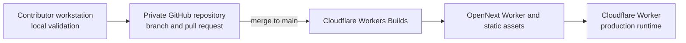

# Architecture

Last reviewed 23 August 2026.

This document describes the current Phase 1 cloud prototype. Proposed archive and
summary components are intentionally separated at the end so they are not mistaken for
implemented behavior.

## System context

```text
Microphone or audio interface
  -> operator browser or internal iOS WebKit shell (Cloudflare Access protected)
  -> selected 6-, 9-, or 12-second audio file over HTTPS
  -> Cloudflare Worker / OpenNext API
  -> Groq Whisper transcription
  -> Groq GPT-OSS 20B contextual translation, unless source equals target
  -> deterministic glossary and public moderation pipeline
  -> authenticated Main-channel API with controller lease
  -> SQLite-backed Durable Object with constant-size shared state
  -> purpose-specific token-authenticated WebSockets
  -> reusable OBS Browser Source and per-service mobile viewer
```

The normal operator path captures audio in a desktop browser, with 1920 × 1080 as the
primary workstation viewport and a responsive path down to 320px. The dashboard content
uses a 1440px ceiling to preserve scanning and reading distance on the wider display. The
internal iPhone/iPad feasibility shell can host the same dashboard in WebKit, but neither
client runs transcription or translation models. The prototype has no separate
sermon/archive database, object storage, or summary service; the Durable Object stores
only constant-size live-channel state.

## Source and deployment path



GitHub is the source-review system only. The repository has no GitHub Actions workflow,
so a push does not consume a GitHub-hosted runner or deploy from GitHub. Cloudflare's
connected build watches `main`, creates the OpenNext bundle, and publishes the Worker.
Cloudflare deployment status is therefore authoritative; contributors run tests, strict
type checking, lint, and builds locally before merge. The manual `npm run deploy` command
is an owner-controlled recovery path, not the normal collaboration flow.

The repository preserves a separate native build experiment: XcodeGen creates
`ios/ChurchLiveCaption.xcodeproj` from `ios/project.yml`. That path was deferred on
10 August 2026 and is not part of current architecture acceptance or release work. The
browser/Cloudflare path is the only active application architecture.

## Components

### Operator browser

The Next.js client provides:

- microphone and browser-visible audio-interface enumeration;
- explicit microphone permission and a live input meter;
- a guided Setup workspace with audio, language, terminology, and service information
  in the left column and preview, appearance, and output controls in the right column,
  followed by a compact Live operator console;
- four Setup-stage labels that match the numbered panels, fluid gutters, and a single-column
  reflow without horizontal scrolling down to the declared 320px minimum;
- a flat monochrome dashboard visual system that keeps operational status legible in
  text and shape while leaving OBS caption colours under operator control;
- readable 13–16px form typography, at least 44px action controls, visible focus, and a
  compact mobile Start bar that retains blocking or takeover context;
- source language, target language, glossary, filter, and shared caption-style controls;
- primary pause/resume and Clear OBS controls, plus secondary test, copy, and confirmed End;
- input-event-driven appearance controls so range and colour changes update the
  dashboard preview continuously before they are saved as the default;
- a `MediaRecorder` that creates independent 6-, 9-, or 12-second audio chunks, with the
  selected buffer snapshotted and locked when the service starts;
- a two-chunk in-memory queue to bound latency and memory use;
- protected source and moderated public-caption previews;
- active-service time, reserved transcription-attempt count, dropped chunk count, and last
  post-recording cloud processing latency;
- one reusable OBS URL, one separate per-service mobile viewer URL, purpose-specific
  rotation/replacement, and confirmed operator takeover; and
- a controller credential in tab `sessionStorage` plus display fallback in `localStorage`.

Glossary text, filter text, audio, captions, and service usage are not persisted by the
browser after the active page/service. The UI has no manual correction, caption history,
archive, or summary controls today. Pause stops browser capture, discards queued chunks,
and keeps the reusable channel and service expiry. The service clock continues while the
reserved transcription-attempt count does not.

### Deferred iOS feasibility shell

The preserved shell under [`ios/`](../ios/README.md) targets iPhone and iPad on iOS 17 or
newer. It is inactive research and not an alternate caption pipeline or current client:

- SwiftUI presents an approved-audio and cloud-processing notice, requests native
  microphone permission, and permits a view-only path;
- `WKWebView` loads the `APP_BASE_URL` value only after configuration rejects a non-HTTPS
  or credential-bearing URL;
- the WebKit media delegate grants microphone capture only to the exact configured HTTPS
  main-frame origin and denies other origins, frames, and media types;
- in-app navigation is limited to the configured dashboard and Cloudflare Access, while
  external user-selected links leave the app;
- a bounded JavaScript bridge accepts service and microphone status only from the exact
  dashboard main frame; it does not receive captions, secrets, or controller credentials;
- becoming inactive stops capture and requests a server pause, while foregrounding
  reconciles the authoritative channel state; the native target has no background-audio
  mode; and
- `PrivacyInfo.xcprivacy` declares only the native `UserDefaults` access used to remember
  acknowledgement of the preflight notice. App Store privacy answers must still cover the
  web client, Cloudflare, and Groq.

Local feasibility evidence from 4 August 2026 consists of a pre-hardening unsigned
simulator build, three passing configuration tests on an iPhone 17 simulator running iOS
26.5, and a pre-hardening unsigned arm64 archive for version 0.1.0 build 1. The hardened
sources define four tests and compiled in a follow-up simulator build attempt, but the
sandbox blocked CoreSimulator asset packaging and the fresh test run. The earlier archive
has no Team or Signing Identity and is not the current release candidate. No result yet
covers a current complete archive, signed build, Organizer validation, App Store Connect,
TestFlight installation, a physical device, Cloudflare Access inside WebKit, `audio/mp4`
`MediaRecorder` output, the protected same-origin APIs, WebSockets, OBS, backgrounding,
device lock, or network interruption.

### Cloudflare Worker and OpenNext

`custom-worker.ts` routes `/overlay`, `/view`, and `/api/live/*` to the live runtime before
the generated OpenNext handler. Next.js serves the dashboard and `/api/ai/*` routes. The
Worker environment provides the Durable Object binding, Access configuration, server-only
Groq credential, and OBS token-encryption secret.

Production protection is layered:

- Cloudflare Access gates the dashboard and all operator/API paths at the edge;
- readiness, transcription, translation, and live-channel mutation handlers also verify
  the signed Access JWT in application code;
- `/api/ai/health` returns configuration booleans and model names but no secret; it
  relies on the deployment's edge Access policy;
- `/overlay*`, `/api/live/overlay*`, `/view*`, and `/api/live/viewer*` require exact,
  narrow Access-layer bypass rules and expose no inference or operator mutations; and
- each WebSocket endpoint validates its own OBS or mobile-viewer credential inside the
  Durable Object. Tokens from one protocol cannot authorize the other.

Access verification checks issuer and audience against Cloudflare's remote JWKS. JWKS
loaders are cached by team domain at module scope.

All JSON and multipart operator requests pass through a shared streaming body reader.
It rejects an oversized declared `Content-Length`, also counts the bytes actually
received when that header is absent or inaccurate, and parses only after the byte limit
passes. Route-specific validation then bounds audio, languages, keyword hints, prompt
context, caption text, control actions, and styles.

### AI provider layer

Phase 1 uses GroqCloud:

- `whisper-large-v3-turbo` for transcription; and
- `openai/gpt-oss-20b` for translation, with low reasoning effort and a bounded
  256-token completion.

The deprecated Free-tier value `llama-3.1-8b-instant` is treated as stale even when it
remains in a dashboard-managed `GROQ_TRANSLATION_MODEL` variable, so an old deployment
override cannot silently defeat the migration. Other explicit model overrides remain
supported and must pass the normal model-availability readiness check. Every translation
completion is capped at 256 tokens; low reasoning effort is sent only to GPT-OSS models.

The browser talks only to same-origin APIs and never receives the Groq key. The dashboard
reads the actual configured model identifiers from `/api/ai/health`, while the server
performs a separate model-availability check before starting a service.

Transcription accepts only WebM, Ogg, or MP4 audio and is bounded to a 3 MB chunk, at
most 40 keyword hints, 100 characters per hint, a bounded multipart request, and a
900-character provider prompt. The prompt asks Whisper to preserve biblical names,
Bible books, verse numbers, and church terms.

Translation is skipped when source and target are the same. Otherwise the model receives
the current source caption, up to the four most recent retained source captions, only
preferred-term mappings relevant to exactly that retained text/context, and an explicit
Simplified or Traditional Chinese output instruction. A fixed system prompt requires one
idiomatic caption, preserves evident tone and intentional repetition, keeps quotation
boundaries, and forbids completing scripture, lyrics, quotations, or missing context.
The context, approved terms, and current caption are encoded as structured untrusted data;
recent context may disambiguate the current caption but may not be translated or repeated.
Provider calls have browser and server timeouts.

`TranscriptionProvider` and `TranslationProvider` keep the client independent of a
specific vendor response shape. Only fields used by the live pipeline cross the
same-origin API boundary; unused provider segment identifiers, timings, provider-only
latency fields, and dormant provider modes are not retained. Summary interfaces will be
introduced only when the archive and review design is approved.

### Deterministic caption pipeline

After AI translation, application code:

1. preserves the source text as the protected browser preview;
2. applies approved glossary mappings to the translated display form;
3. applies whole-term public moderation rules; and
4. publishes only the resulting public text to the live room.

The current UI supports mask rules. The pipeline keeps moderation separate from the
protected source form so a public filter never silently rewrites what was spoken. No
protected transcript is sent to OBS or stored in the Durable Object.

### Durable Object, OBS overlay, and mobile viewer

The authenticated one-time Create action initializes the deterministic `channel:main`
Durable Object and produces a 256-bit OBS token. The URL stores `main.token` in its
fragment. The self-contained overlay extracts it and supplies the token as a WebSocket
subprotocol, keeping the bearer value out of the document request and query string.

The Worker derives an AES-GCM key from the server-only
`OBS_CHANNEL_ENCRYPTION_KEY`. The Durable Object stores the encrypted token for recovery
by Access-approved collaborators and its SHA-256 hash for public WebSocket validation.
Starting a service creates separate 256-bit controller and mobile-viewer tokens. Only
their hashes are stored, while the raw controller and viewer URL stay in the operator
tab's `sessionStorage`. A new service always creates a new viewer token.

The Durable Object stores:

- encrypted OBS token and SHA-256 validation hash;
- shared caption style and a channel-wide sequence number;
- idle/live/paused state, controller and current viewer hashes, service timestamps,
  transcription-request count, and event count; and
- the latest moderated public caption.

The Durable Object assigns monotonically increasing sequence numbers, limits public
caption length, and broadcasts captions, clears, style, and service-state changes.
Transactions serialize caption/control/takeover mutations. Before provider work for each
audio chunk, the browser has the Durable Object validate its controller and atomically
reserve one of the 900 allotted transcription attempts. The server-owned counter survives
reload and takeover, and stops a displaced tab before its next provider request. A takeover
atomically replaces the controller and viewer hashes and clears public output; stale
controller requests return `controller_replaced`. A new or reconnected overlay receives
current style, state, and at most the latest public caption.

End and the 90-minute alarm deactivate only the service: they delete the controller,
viewer hash, and latest caption but keep the OBS credential, shared style, and sequence.
Explicit OBS Rotate is allowed only while idle; it replaces the reusable credential and
closes existing OBS sockets with the revocation close code. Protected mobile-link
replacement is allowed only for the current controller, changes only the service viewer
hash, and immediately closes existing viewer sockets.

The protected control endpoint accepts Pause, Resume, Clear, and Show test. Pause and
Resume clear the display, Pause blocks live-caption writes, and Show test is permitted
while idle or paused. Test content comes from bounded application constants and never
calls the AI provider. Reload recovery validates the tab controller and forces the
service into a safe paused state before microphone capture can resume.

The overlay document has no Next.js asset dependency, provider credential, operator
control, history request, or archive capability. It renders a transparent 1920 × 1080
friendly canvas and reconnects with bounded exponential delay.

The overlay remains connected while idle and shows a transparent blank canvas. It retries
abnormal closures at most 12 times with exponential delay capped at 30 seconds, never
renders operational errors publicly, and stops immediately when explicit rotation closes
the old source with code `4001`.

The self-contained mobile document reads a different per-service token from its fragment
and opens the `church-caption-viewer-v1` protocol. It renders a single current moderated
translation plus target language and service status using `textContent`; it has no source
text, caption history, style payload, operator control, OBS credential, or inference route.
Late joiners receive at most the current caption. Pause clears the caption but retains the
connection. Replacement, End, expiry, and takeover close viewers with terminal codes;
other disconnects use a bounded reconnect loop. Security headers disable caching,
indexing, framing, referrers, and sensitive browser permissions.

## Language representation

The product locale is kept separate from Groq's speech code:

| Product selection | Locale | Speech code |
| --- | --- | --- |
| English | `en` | `en` |
| Indonesian | `id` | `id` |
| Japanese | `ja` | `ja` |
| Korean | `ko-KR` | `ko` |
| Tagalog | `tl-PH` | `tl` |
| Chinese (Simplified) | `zh-Hans` | `zh` |
| Chinese (Traditional) | `zh-Hant` | `zh` |
| Vietnamese | `vi` | `vi` |

Chinese script is a text-output preference rather than a separate acoustic language.
Automatic Chinese detection resolves to the Simplified product locale; operators should
select the source explicitly when script-specific handling matters.

## State and retention

| Data | Location | Lifetime |
| --- | --- | --- |
| Raw audio chunk | Browser, Worker request, Groq inference | One active inference request |
| Recent source context | Browser memory | Active page/service |
| Protected source preview | Browser memory | Active page/service |
| Moderated public caption | Browser and Durable Object | Latest item until clear, End, or expiry |
| Browser fallback caption style | Browser `localStorage` | Until cleared in that browser |
| Shared caption style | Durable Object | Channel lifetime |
| OBS token | Encrypted Durable Object value; URL fragment and OBS memory | Until explicit rotation |
| OBS token hash and channel sequence | Durable Object | Channel lifetime |
| Controller token/hash | Tab `sessionStorage` / Durable Object | Active service, maximum 90 minutes |
| Mobile viewer token/hash | URL fragment and operator-tab `sessionStorage` / Durable Object hash | Active service; replaced on demand and deleted on End, expiry, or takeover |
| Service state, timestamps, and event count | Durable Object | Active service; state resets on End/expiry |
| Reserved transcription-attempt count | Durable Object | Active service; resets on End/expiry |
| Dropped-chunk and processing-latency metrics | Browser memory | Active page/service |
| Native processing-notice acknowledgement | iOS app-local preferences | Until app data is cleared |

Groq may retain provider-side data according to the active organization's Data Controls.
Zero Data Retention is a deployment prerequisite for approved sermon audio; provider
usage metadata remains outside this application's control.

## Limits and failure behavior

- The active service ends after 90 minutes and allows at most 1,400 caption events.
- The selectable 6-, 9-, or 12-second windows share a hard ceiling of 900 reserved
  transcription attempts per service, derived from the fastest option and including
  provider failures and silent results.
- Each successful non-silent chunk whose source differs from its target can make one
  additional translation request, so a service can make at most 900 translation calls.
- Each attempted chunk first makes one low-volume controller-lease request that reserves
  the counter atomically. It adds no Groq call and prevents reload or takeover from
  resetting or bypassing the ceiling.
- The room accepts at most 250 concurrent mobile-viewer sockets; additional connections
  fail closed without affecting OBS or operator control.
- The dashboard latency metric starts after the selected window finishes recording. It
  measures upload, transcription, translation, processing, and publication; approximate
  spoken-to-screen time is the selected 6, 9, or 12 seconds plus that value and rendering
  delay. A fixed window can reduce fragmentation but cannot guarantee a semantic boundary.
- When two chunks are already queued, a new chunk is dropped and the operator is warned.
- Pausing deliberately discards the unfinished active window and queued audio without
  counting them as dropped chunks; paused time still counts toward service expiry.
- Safe margins are bounded to 0–20% per axis and use viewport-relative units in OBS.
- A transcription quota, authentication, language-detection, or service-expiry error
  ends the service while preserving the OBS URL.
- Other transient provider errors are shown while the next queued chunk may retry the
  normal flow; no caption is fabricated.
- Translation currently has no source-language fallback. A translation error is visible
  to the operator and that chunk is not published.
- The overlay reconnects and restores only the latest public caption, not missed history.
- End or expiry clears public/service state and revokes the mobile link while preserving
  the OBS URL. Only explicit OBS Rotate revokes the reusable OBS link.
- A normal second start returns `channel_in_use`; confirmed takeover replaces the active
  controller and prevents two microphones from publishing to the same channel.
- There is no automatic paid provider or overage path.

Current UI usage is service-local. Groq organization limits and Cloudflare account limits
can be consumed by other applications or services, so provider dashboards are the
authoritative account-wide meters. The service ceiling of 900 reserved transcription
attempts stays below the replacement model's 1,000-request daily Free limit for one
uninterrupted service, but its 200,000-token daily allowance can still fail earlier for
content-heavy prompts.

## Deferred architecture

Archive and AI summary work is not part of the live prototype. Before adding it, the
project needs explicit decisions and a separate threat/privacy design for:

- church workspaces, roles, and row-level authorization;
- consent and recording state visible to operators and participants;
- source, translated, corrected, and public transcript forms;
- approved Bible versions, licensing, and reference metadata;
- summary grounding, uncertainty flags, and human approval;
- retention, export, deletion, backup, and audit behavior; and
- storage/provider cost caps.

Supabase or another database remains an option, not a current dependency or decision.

## Code and dependency boundary

The web production dependency surface is deliberately small: Next.js, React, React DOM, and
`jose` for Cloudflare Access JWT verification. Cloudflare/OpenNext, Wrangler, TypeScript,
ESLint, Vitest, and type packages are development-only build or validation dependencies.
The project contains no local-model runtime, database client, analytics SDK, paid-provider
fallback, or sermon-storage library. Convention-loaded build files are verified through
the OpenNext build rather than deleted solely because a static import graph cannot see
their loader.

The iOS shell uses Apple SwiftUI, WebKit, AVFoundation, an asset catalogue, and a privacy
manifest generated into an Xcode project by XcodeGen. It adds no JavaScript or Swift
package dependency and embeds no web-service secret. Its Xcode build, tests, signing, and
distribution gates remain separate from `npm run validate`.

The PostCSS override is pinned to patched version 8.5.23. As of 23 August 2026, both the
production-only and full dependency audits are clean after compatible Nano ID, JS-YAML,
Wrangler, Miniflare, and Undici updates documented in the validation report.

## Validation priorities

Before a controlled live pilot, validate with synthetic or approved recordings:

- the deployed Git revision and configured model identifiers;
- every source and target language, accents, mixed-language speech, and Chinese scripts;
- biblical names, Bible references, numbers, glossary mappings, and filter boundaries;
- latency and dropped-chunk behavior for an entire service;
- all three buffer choices and the prompt's idiom, repetition, incomplete-speech, quote,
  and non-invention behavior;
- mobile-viewer late join, pause, replacement, End, expiry, takeover, Access boundaries,
  and the 250-connection ceiling;
- Groq `429`, timeout, invalid-model, and network-loss behavior;
- device disconnect and microphone permission failure;
- Access rejection, bypass route scope, token theft, controller replacement, takeover,
  explicit rotation, and service expiry;
- OBS initial connection, reconnection, styling, and browser-source compatibility; and
- actual Cloudflare and Groq account usage against the intended Free plans.

Native validation is not a current priority or release gate. If the experiment is ever
reopened, define fresh signed-device, authentication, audio, WebSocket, lifecycle,
responsive-layout, privacy, and isolated-backend acceptance criteria first.
