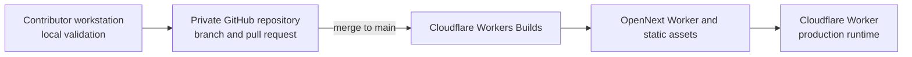

# Architecture

This document describes the current Phase 1 cloud prototype. Proposed archive and
summary components are intentionally separated at the end so they are not mistaken for
implemented behavior.

## System context

```text
Microphone or audio interface
  -> operator browser (Cloudflare Access protected)
  -> four-second audio file over HTTPS
  -> Cloudflare Worker / OpenNext API
  -> Groq Whisper transcription
  -> Groq Llama contextual translation, unless source equals target
  -> deterministic glossary and public moderation pipeline
  -> authenticated Main-channel API with controller lease
  -> SQLite-backed Durable Object with constant-size shared state
  -> reusable token-authenticated WebSocket
  -> OBS Browser Source
```

The operator's Mac captures audio in the browser but does not run transcription or
translation models. The prototype has no application database, object storage, sermon
archive, or summary service.

## Source and deployment path



GitHub is the source-review system only. The repository has no GitHub Actions workflow,
so a push does not consume a GitHub-hosted runner or deploy from GitHub. Cloudflare's
connected build watches `main`, creates the OpenNext bundle, and publishes the Worker.
Cloudflare deployment status is therefore authoritative; contributors run tests, strict
type checking, lint, and builds locally before merge. The manual `npm run deploy` command
is an owner-controlled recovery path, not the normal collaboration flow.

## Components

### Operator browser

The Next.js client provides:

- microphone and browser-visible audio-interface enumeration;
- explicit microphone permission and a live input meter;
- a guided Setup workspace with audio, language, terminology, and service information
  in the left column and preview, appearance, and OBS controls in the right column,
  followed by a compact Live operator console;
- source language, target language, glossary, filter, and shared caption-style controls;
- primary pause/resume and clear controls, plus secondary test, copy, and confirmed End;
- input-event-driven appearance controls so range and colour changes update the
  dashboard preview continuously before they are saved;
- a `MediaRecorder` that creates independent four-second audio chunks;
- a two-chunk in-memory queue to bound latency and memory use;
- protected source and moderated public-caption previews;
- active-service time, transcription request count, dropped chunk count, and last
  post-recording cloud processing latency;
- one reusable OBS URL, explicit rotation, and confirmed operator takeover; and
- a controller credential in tab `sessionStorage` plus display fallback in `localStorage`.

Glossary text, filter text, audio, captions, and service usage are not persisted by the
browser after the active page/service. The UI has no manual correction, caption history,
archive, or summary controls today. Pause stops browser capture, discards queued chunks,
and keeps the reusable channel and service expiry. The service clock continues while the
transcription-request count does not.

### Cloudflare Worker and OpenNext

`custom-worker.ts` routes `/overlay` and `/api/live/*` to the live runtime before the
generated OpenNext handler. Next.js serves the dashboard and `/api/ai/*` routes. The
Worker environment provides the Durable Object binding, Access configuration,
server-only Groq credential, and OBS token-encryption secret.

Production protection is layered:

- Cloudflare Access gates the dashboard and all operator/API paths at the edge;
- readiness, transcription, translation, and live-channel mutation handlers also verify
  the signed Access JWT in application code;
- `/api/ai/health` returns configuration booleans and model names but no secret; it
  relies on the deployment's edge Access policy;
- `/overlay*` and `/api/live/overlay*` are narrowly bypassed at the Access layer and
  expose no inference or operator mutations; and
- the WebSocket endpoint validates the reusable channel credential inside the Durable Object.

Access verification checks issuer and audience against Cloudflare's remote JWKS. JWKS
loaders are cached by team domain at module scope.

All JSON and multipart operator requests pass through a shared streaming body reader.
It rejects an oversized declared `Content-Length`, also counts the bytes actually
received when that header is absent or inaccurate, and parses only after the byte limit
passes. Route-specific validation then bounds audio, languages, keyword hints, prompt
context, caption text, control actions, and styles.

### AI provider layer

Phase 1 uses GroqCloud:

- `whisper-large-v3-turbo` for transcription; and
- `llama-3.1-8b-instant` for translation.

The browser talks only to same-origin APIs and never receives the Groq key. The server
performs a model-availability check before starting a service.

Transcription accepts only WebM, Ogg, or MP4 audio and is bounded to a 3 MB chunk, at
most 40 keyword hints, 100 characters per hint, a bounded multipart request, and a
900-character provider prompt. The prompt asks Whisper to preserve biblical names,
Bible books, verse numbers, and church terms.

Translation is skipped when source and target are the same. Otherwise the model receives
the current source caption, up to four recent source captions, at most 60 preferred-term
mappings, and an explicit Simplified or Traditional Chinese output instruction. It is
told to return translation only and not invent scripture, doctrine, facts, or meaning.
Provider calls have browser and server timeouts.

`TranscriptionProvider` and `TranslationProvider` keep the client independent of a
specific vendor response shape. Only fields used by the live pipeline cross the
same-origin API boundary; unused provider segment identifiers, timings, and provider-only
latency fields are discarded. Summary interfaces will be introduced only when the archive
and review design is approved.

### Deterministic caption pipeline

After AI translation, application code:

1. preserves the source text as the protected browser preview;
2. applies approved glossary mappings to the translated display form;
3. applies whole-term public moderation rules; and
4. publishes only the resulting public text to the live room.

The current UI supports mask rules. The pipeline keeps moderation separate from the
protected source form so a public filter never silently rewrites what was spoken. No
protected transcript is sent to OBS or stored in the Durable Object.

### Durable Object and OBS overlay

The authenticated one-time Create action initializes the deterministic `channel:main`
Durable Object and produces a 256-bit OBS token. The URL stores `main.token` in its
fragment. The self-contained overlay extracts it and supplies the token as a WebSocket
subprotocol, keeping the bearer value out of the document request and query string.

The Worker derives an AES-GCM key from the server-only
`OBS_CHANNEL_ENCRYPTION_KEY`. The Durable Object stores the encrypted token for recovery
by Access-approved collaborators and its SHA-256 hash for public WebSocket validation.
Starting a service creates a separate 256-bit controller token; only its hash is stored,
while the raw controller stays in the operator tab's `sessionStorage`.

The Durable Object stores:

- encrypted OBS token and SHA-256 validation hash;
- shared caption style and a channel-wide sequence number;
- idle/live/paused state, controller hash, service timestamps, transcription-request
  count, and event count; and
- the latest moderated public caption.

The Durable Object assigns monotonically increasing sequence numbers, limits public
caption length, and broadcasts captions, clears, style, and service-state changes.
Transactions serialize caption/control/takeover mutations. Before each transcription
chunk, the browser validates its controller lease and atomically reserves one of 1,350
requests through the Durable Object. The server-owned counter survives reload and
takeover, and stops a displaced tab before its next provider request. A takeover atomically
replaces the controller hash and clears OBS; stale controller requests return
`controller_replaced`. A new or reconnected overlay receives current style, state, and
at most the latest public caption.

End and the 90-minute alarm deactivate only the service: they delete the controller and
latest caption but keep the OBS credential, shared style, and sequence. Explicit Rotate
is allowed only while idle; it replaces the credential and closes existing sockets with
the revocation close code.

The protected control endpoint accepts Pause, Resume, Clear, and Show test. Pause and
Resume clear the display, Pause blocks live-caption writes, and Show test is permitted
while idle or paused. Test content comes from bounded application constants and never
calls the AI provider. Reload recovery validates the tab controller and forces the
service into a safe paused state before microphone capture can resume.

The overlay document has no Next.js asset dependency, provider credential, operator
control, history request, or archive capability. It renders a transparent 1920 × 1080
friendly canvas and reconnects with bounded exponential delay.

The overlay remains connected while idle and shows a transparent blank canvas. It retries
abnormal closures at most 12 times with exponential delay capped at 30 seconds, never
renders operational errors publicly, and stops immediately when explicit rotation closes
the old source with code `4001`.

## Language representation

The product locale is kept separate from Groq's speech code:

| Product selection | Locale | Speech code |
| --- | --- | --- |
| English | `en` | `en` |
| Indonesian | `id` | `id` |
| Japanese | `ja` | `ja` |
| Korean | `ko-KR` | `ko` |
| Tagalog | `tl-PH` | `tl` |
| Chinese (Simplified) | `zh-Hans` | `zh` |
| Chinese (Traditional) | `zh-Hant` | `zh` |
| Vietnamese | `vi` | `vi` |

Chinese script is a text-output preference rather than a separate acoustic language.
Automatic Chinese detection resolves to the Simplified product locale; operators should
select the source explicitly when script-specific handling matters.

## State and retention

| Data | Location | Lifetime |
| --- | --- | --- |
| Raw audio chunk | Browser, Worker request, Groq inference | One active inference request |
| Recent source context | Browser memory | Active page/service |
| Protected source preview | Browser memory | Active page/service |
| Moderated public caption | Browser and Durable Object | Latest item until clear, End, or expiry |
| Shared caption style | Browser local storage and Durable Object | Channel lifetime |
| OBS token | Encrypted Durable Object value; URL fragment and OBS memory | Until explicit rotation |
| OBS token hash and channel sequence | Durable Object | Channel lifetime |
| Controller token/hash | Tab `sessionStorage` / Durable Object | Active service, maximum 90 minutes |
| Service state, timestamps, and event count | Durable Object | Active service; state resets on End/expiry |
| Service usage counters | Browser memory | Active page/service |

Groq may retain provider-side data according to the active organization's Data Controls.
Zero Data Retention is a deployment prerequisite for approved sermon audio; provider
usage metadata remains outside this application's control.

## Limits and failure behavior

- The active service ends after 90 minutes and allows at most 1,400 caption events.
- Four-second chunks have a hard ceiling of 1,350 reserved transcription attempts per
  service, including provider failures and silent results.
- Each attempted chunk first makes one low-volume controller-lease request that reserves
  the counter atomically. It adds no Groq call and prevents reload or takeover from
  resetting or bypassing the ceiling.
- The dashboard latency metric starts after a four-second chunk finishes recording. It
  measures upload, transcription, translation, processing, and publication; approximate
  spoken-to-screen time is four seconds plus that value and rendering delay.
- When two chunks are already queued, a new chunk is dropped and the operator is warned.
- Pausing deliberately discards queued audio without counting it as a dropped chunk;
  paused time still counts toward the 90-minute service expiry.
- Safe margins are bounded to 0–20% per axis and use viewport-relative units in OBS.
- A transcription quota, authentication, language-detection, or service-expiry error
  ends the service while preserving the OBS URL.
- Other transient provider errors are shown while the next queued chunk may retry the
  normal flow; no caption is fabricated.
- Translation currently has no source-language fallback. A translation error is visible
  to the operator and that chunk is not published.
- The overlay reconnects and restores only the latest public caption, not missed history.
- End or expiry clears public/service state but preserves the URL. Only Rotate revokes it.
- A normal second start returns `channel_in_use`; confirmed takeover replaces the active
  controller and prevents two microphones from publishing to the same channel.
- There is no automatic paid provider or overage path.

Current UI usage is service-local. Groq organization limits and Cloudflare account limits
can be consumed by other applications or services, so provider dashboards are
the authoritative account-wide meters.

## Deferred architecture

Archive and AI summary work is not part of the live prototype. Before adding it, the
project needs explicit decisions and a separate threat/privacy design for:

- church workspaces, roles, and row-level authorization;
- consent and recording state visible to operators and participants;
- source, translated, corrected, and public transcript forms;
- approved Bible versions, licensing, and reference metadata;
- summary grounding, uncertainty flags, and human approval;
- retention, export, deletion, backup, and audit behavior; and
- storage/provider cost caps.

Supabase or another database remains an option, not a current dependency or decision.

## Validation priorities

Before a controlled live pilot, validate with synthetic or approved recordings:

- every source and target language, accents, mixed-language speech, and Chinese scripts;
- biblical names, Bible references, numbers, glossary mappings, and filter boundaries;
- latency and dropped-chunk behavior for an entire service;
- Groq `429`, timeout, invalid-model, and network-loss behavior;
- device disconnect and microphone permission failure;
- Access rejection, bypass route scope, token theft, controller replacement, takeover,
  explicit rotation, and service expiry;
- OBS initial connection, reconnection, styling, and browser-source compatibility; and
- actual Cloudflare and Groq account usage against the intended Free plans.
