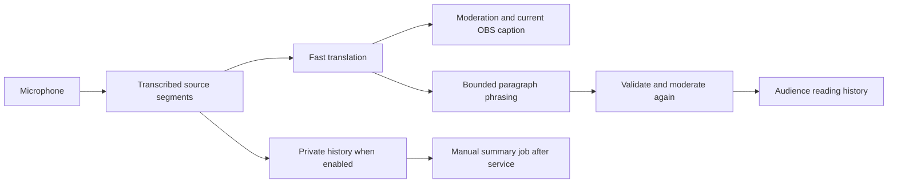

# LIVE_SESSION_FEEDBACK_PLAN_1

Implementation review: 13 September 2026. The approved plan merged in PR #26 at
`20597d8` and deployed after the [proxy fix](DEPLOYMENT.md). Protected runtime rehearsal
and real-sermon acceptance remain pending.
See [implementation decisions](decisions/0011-service-history-and-optional-inference.md)
for exact storage, provider, limits, and release gates. The sections below preserve the
product design; the implementation choices in that decision record take precedence.

Implemented first-release choices: 30-second shared reader cadence; translated public
chunks only as reader input; seven-day opt-in archive; 30-minute reader grace; JSON
exports; Cloudflare Workers AI behind an explicit deployment switch. Current OBS and
`/view` remain free of extra inference. No exact TB2 passage import or automatic model
training is included. Physical-device and semantic quality checks require a rehearsal.

## Implemented choices versus the original proposal

The numbered sections retain the approved design and its evaluated alternatives. Use
this matrix and ADR 0011 for the delivered first-release scope:

| Area | Implemented choice | Still deferred or unverified |
| --- | --- | --- |
| Reader | 30-second shared cadence, at most five moderated translation chunks per batch; 200 calls/service | Natural-boundary quality, physical latency and rich grammar guarantees |
| History | Default-off, immutable pre-Start opt-in; seven days after End/expiry; JSON export | Mid-service opt-in, tenant roles and physical backup-erasure guarantees |
| Summary | Manual ended-service job, allowlisted Workers AI models, language/length/guidance and source IDs; review before JSON export | Section selector, editable structured summary, other providers and exact TB2 retrieval |
| Storage | Three SQLite Durable Objects and alarms | D1 and Queues alternatives were not selected |
| Names | TB2 names and explicitly approved whole-word aliases | Persistent reusable packs, identity notes/database and automatic learning |
| Clear/Remove | Clear pending/live output; Remove excludes a public paragraph's sources and invalidates summary | Remove requests a clear when current output matches its source IDs; it does not publish a correction |
| Reader access | Active service plus 30-minute grace; immediate server revocation on replacement/takeover/deletion | Disconnected clients update on successful poll, not instant offline erasure |
| Usage | Numeric rolling 30-day ledger; separate provider/stage totals and conservative optional-AI reservations | Account-wide billing and a renewable monthly token allowance |

Optional Workers AI remains disabled unless explicitly enabled. The original alternative
provider/20-second cost examples below are design comparisons, not measured consumption
or the current call budget. The implementation makes no per-viewer inference call.

## Confirmed decisions

- The operator's phone remotely controls the computer capturing microphone audio.
- Transcript saving requires an explicit choice before the service. Saved history is
  private and automatically deleted seven days after the service ends or expires.
- Preserve numeric AI usage across services for a rolling 30 days, independently of
  transcript saving. Show actual consumption and a separately labelled capacity estimate.
  This does not change the seven-day retention of sermon content.
- Use Indonesian **Terjemahan Baru Edisi Kedua (TB2)** as the selected Bible edition
  for reference material. The summary's output language remains independently selectable.
- First reported terminology regression: Indonesian speech produced `swauf`; the
  expected name was `Saul`. The operator could not distinguish the affected stage;
  the target language was not specified. Diagnose with a controlled replay.

The existing protected operator, fast OBS overlay, and latest-caption mobile viewer
remain available. The new remote, reader, and archive use separate roles and credentials.

## 1. Biblical names

Add a reviewed, reusable Bible terminology profile and a smaller service vocabulary.
Each entry holds the source spelling, approved recognition variants, target-language
spelling, and optional identity/context notes. Prioritize the current sermon's names
and passages over loading an entire Bible vocabulary into every request.

During a controlled replay, compare the recognized source with the translated output.
Recognition errors need source-language spelling hints; translation errors need approved
target mappings. Add the reported case to the evaluation set. Preserve `Saul` as requested;
do not infer which biblical person was intended or substitute another name automatically.

An operator-approved correction may become a reusable vocabulary entry after review.
This is explicit vocabulary improvement, not automatic model training. Avoid global
fuzzy replacements that could change unrelated speech. Do not invent missing names or
complete scripture from memory.

Groq documents spelling/context hints with a 224-token transcription prompt limit.
Use a compact, source-language hint budget; a character limit alone is insufficient.
[Groq speech-to-text documentation](https://console.groq.com/docs/speech-to-text).

## 2. Separate operator and audience experiences

| Surface | Purpose | Access |
| --- | --- | --- |
| Capture computer | Microphone, setup, fast translation, diagnostics | Authenticated operator and active capture controller |
| Operator phone | Status, Pause, Resume, Clear live caption | Authenticated, explicitly paired remote control |
| OBS | Immediate current caption | Existing read-only OBS credential |
| Audience reader | Appending, readable translated paragraphs | Separate read-only service reader credential |

Implemented routes are `/operator/mobile` and `/read`. Keep the existing latest-caption
viewer available. Never add operator permissions to an audience bearer link.

The phone sends service-scoped commands to the server; it does not start its own
microphone or take over the capture controller. Commands have unique IDs and require
acknowledgement from the capture computer. The UI distinguishes pending, confirmed,
failed, and capture-device-disconnected states.

Pause immediately blocks new server inference claims, then the computer stops capture
and cancels pending work. Do not claim the physical microphone stopped until acknowledged.
Resume requires the computer to be connected and ready; missing browser microphone
permission requires action on that computer. Retry of the same command must be harmless.
End and controller replacement revoke remote pairing. Pairing never exposes the full
capture-controller credential in a URL.

## 3. Readable audience text

The reader's phrasing stage receives only ordered moderated translations. Approved
names and filters are applied deterministically again before commit. It joins chunk boundaries,
restores punctuation, and improves grammar while preserving meaning. Excluded segments
must not enter public phrasing context. Apply public moderation again after generation.

Proposed first target: batch pending material roughly every 20–30 seconds, closing at
natural sentence boundaries when possible. Measure actual spoken-to-readable latency
separately. An unfinished sentence may remain incomplete; waiting longer is not permission
to invent its ending.

Only the newest draft paragraph may change automatically. Committed paragraphs remain
stable except for an explicit correction or removal. Every paragraph references its source
segment IDs and revision. Reconnects and duplicate jobs must not append duplicate text.
Never repeatedly rewrite the whole sermon.

Reader behavior:

- Auto-follow new text only when the reader is already near the bottom. Otherwise show
  a new-text indicator and a Return to live button.
- Provide text sizing, readable spacing, connection state, and processing delay.
- With saving enabled, reload and late join recover paginated public paragraphs from
  the current service. Source transcripts and private summaries remain inaccessible.
- With saving disabled, append text in the current browser only; offer no durable
  history recovery or summary. Keep source/context buffers bounded and discard processed
  source material. Do not silently store transcripts in browser localStorage.
- If phrasing fails, append the available moderated translations with a processing
  warning. Do not block OBS or create an unlimited retry backlog.

One phrasing job serves all viewers of the service's active target language. Opening
more audience phones must not trigger more AI calls.

## 4. Clear, pause, refresh, and end

The ordinary UI action is **Clear captions** (called Clear live caption in this design).
It clears current output, not committed history.

| Action | OBS/operator current caption | Audience reader | Saved transcript and summary input |
| --- | --- | --- | --- |
| Clear live caption | Blank immediately; capture continues | Keep committed paragraphs; discard unfinished draft | Preserve captured history |
| Pause | Stop capture and blank current caption | Keep committed paragraphs; show Paused; discard unfinished draft | Preserve history; mark a boundary |
| Resume | Start new audio after acknowledgement | Append from the new boundary | Continue the same service |
| Refresh translation settings | Clear current caption and reset pending work | Preserve earlier text; start a labelled section, including language when changed | Preserve per-segment settings/revisions |
| Remove a passage | Clear it if currently displayed | Remove the selected passage | Mark its source spans excluded from phrasing and summaries |
| End service | Stop capture and clear OBS | Finish bounded accepted work, then show Service ended | Finalize the saved source revision |
| Delete saved sermon | No historical display remains available | Revoke reader access and clear connected readers | Delete transcript, paragraphs, summaries, and pending jobs |

Clear needs a server sequence boundary: late work begun before Clear cannot repaint
OBS or reintroduce the discarded reader draft. New speech after that boundary continues
normally. Pause and refresh also establish boundaries that phrasing cannot stitch across.

Removing a passage is a separate, confirmed action. It invalidates pending work and
derived summaries using those source spans. A new summary excludes them. It does not
purge the original private record; Delete saved sermon performs that deletion. Previously
viewed text, screenshots, and exports cannot be recalled.

Proposed reader-link lifetime: the active service plus a 30-minute reading window after
End or expiry. Afterward access is denied; the private archive still follows its seven-day
retention. This differs deliberately from the existing latest-caption viewer, whose link
expires immediately at End. Link replacement or security revocation remains immediate.

## 5. Manual sermon summary

Add **Save transcript for summary — deletes after 7 days** before Start, off by default,
with a visible saving indicator and the church's participant notice. Persist segments
during capture so reloads do not lose the sermon. Enabling saving later cannot recover
earlier discarded speech; mark any resulting archive as partial.

After End: finalize accepted history, show coverage/gaps, then offer **Generate summary**.
Ending a service never automatically generates one. The summary uses a frozen source
revision with reviewed corrections and exclusion markers, rather than relying only on
the already rephrased audience text.

A separate configurable summary assistant fits this workflow. Give it its own approved
model selection, editable operator guidance, output language, length, and section choices.
Keep generation as a bounded background job. Long transcripts can use segment-linked
section summaries followed by one synthesis; they do not require an autonomous tool loop.

Default sections: theme, outline, main points, explicitly mentioned scripture references,
speaker-stated applications, and transcription gaps/uncertainties. Each substantive point
links to supporting transcript segments and timestamps. Do not invent references,
quotations, missing sermon sections, or claims that a paraphrase is an exact quotation.

An immutable server policy enforces grounding and data-only treatment of transcripts.
Editable guidance can change tone and structure but cannot override that policy.
Generation snapshots the model, prompt version, and transcript revision. Prompt edits
affect the next manually requested generation. Show queued, running, completed, and failed
states; duplicate clicks must not launch duplicate jobs.

Summaries stay private drafts until an operator reviews and explicitly shares or exports
them. Audience reader links do not grant archive or summary access. Regeneration does not
extend retention. Provide transcript export and Delete saved sermon.

### Separate summary provider and Bible context

Proposal following the usage discussion: configure the summary provider independently
of live transcription, live translation, and reader phrasing. This lets a manual summary
use a separate provider allowance without consuming Groq's live-translation quota.
Keep one summary job shared by the service; audience count has no effect on its cost.
This proposal does not change the live provider or enable any new external processing.

First evaluation candidate: **Cloudflare Workers AI**, which fits the existing Worker
deployment. Its free allocation is 10,000 neurons per day, shared across Workers AI
usage in the account; free allocation does not mean unlimited calls. On Workers Free,
exceeding it fails. Workers Paid permits billable overage, so the application must
enforce its own no-overage policy and account for other account workloads before any
real-data rollout. Cloudflare states that it does not use Customer Content for model
training or service improvement without explicit consent. This is not a blanket claim
about the retention of application storage or separately enabled logging products.
[Workers AI pricing](https://developers.cloudflare.com/workers-ai/platform/pricing/),
[Workers AI data usage](https://developers.cloudflare.com/workers-ai/platform/data-usage/).

Evaluate `@cf/meta/llama-3.3-70b-instruct-fp8-fast` as an initial available candidate,
not a quality winner selected without testing. Its documented context window is
24,000 tokens. Bound each request's combined transcript, context, instructions, and
output; use section summaries and synthesis when the full sermon does not fit.
Its published accounting rates are 26,668 neurons per million input tokens and
204,805 per million output tokens. For illustration, 20,000 input plus 2,000 output
tokens across a job would be about 943 neurons. Repeated section prompts, synthesis,
retries, and actual output can increase this; it is not a measured per-sermon cost or
a promise of daily sermon capacity.
[Model specification](https://developers.cloudflare.com/workers-ai/models/llama-3.3-70b-instruct-fp8-fast/),
[Neuron rates](https://developers.cloudflare.com/workers-ai/platform/pricing/).

Other candidates remain configurable extensions rather than automatic fallbacks:

- **Cerebras:** a separate free inference tier exists. Verify the chosen model's
  current account access, context limit, rate limits, and data terms before evaluation;
  older free-context numbers must not be assumed current. A smaller allowed context
  requires more section-summary calls.
  [Cerebras limits](https://inference-docs.cerebras.ai/support/rate-limits),
  [Cerebras pricing](https://www.cerebras.ai/pricing).
- **Gemini unpaid API:** supports free use for selected models, but its unpaid-service
  terms allow submitted content and responses to improve products and permit human
  review. They instruct users not to submit sensitive, confidential, or personal
  information. Regional/account exceptions exist, but this is not the default choice
  for the planned private transcript archive. Synthetic evaluation is separate from
  authorization to send real sermon content.
  [Gemini terms](https://ai.google.dev/gemini-api/terms).

Supply a compact, versioned **Bible context pack** alongside each frozen transcript:

1. Indonesian **TB2**, approved name spellings and book aliases, and optional sermon
   title or planned passages. Preserve the operator-approved `Saul` regression case;
   do not infer which person was intended. Do not substitute another Bible edition
   or import unlicensed Bible text.
2. Only relevant passages from an authorized source, located by validated book,
   chapter, and verse. Exact reference lookup can be deterministic and needs no
   embedding model. Uncertain spoken references remain review items; do not invent
   a citation from the model's memory.
3. Separate provenance for transcript evidence, operator context, and retrieved Bible
   text. The sermon is the authority for what the speaker said. Context can clarify a
   known name or verify a reference; it must not add unspoken lessons, automatically
   identify an ambiguous Saul, or silently change the speaker's interpretation.

Keep any optional Bible background outside the sermon summary in a labelled, separately
cited section. A supplied planned passage is not evidence that the speaker discussed
it. Exact Bible quotations must come from the selected source/edition, not a generated
reconstruction. Reviewed name corrections are part of the frozen source revision;
unresolved recognition errors remain flagged even if the model knows a plausible story.

TB2 text access remains to be verified. LAI's public text-use policy currently identifies
TB (1974) in its attribution example; it does not by itself establish permission for
bulk TB2 ingestion or a particular API integration. Do not treat a public reading site
as an authorized full-text dataset. Start with transcript-based summaries and the
approved glossary; exact TB2 passage enrichment requires an authorized source and the
applicable attribution. No verified TB2 API was identified in the initial research.
[LAI text-use policy](https://alkitab.or.id/tentang-kami/penggunaan-teks).

The summary assistant combines immutable grounding rules, operator-adjustable output
guidance, the context pack, and transcript segments with IDs/timestamps. It needs neither
model training nor an autonomous browsing/tool loop. The context pack still consumes
input tokens. Validate structured output and source references, then require operator
review for semantic accuracy; a well-formed citation alone does not prove a claim.

Record provider/model, returned token usage, and provider-native units separately in
the 30-day usage ledger. Neurons and tokens are different units; identify any neuron
conversion as an estimate with its pricing version. Summary quota exhaustion leaves
the job available for a later manual retry before archive expiry, without silently
switching provider, using paid capacity, or disrupting live captions.

## 6. Storage, limits, and failure handling

Keep the Durable Object focused on current service state, control commands, sequence
boundaries, and delivery. Use paginated persistent records for opted-in transcripts,
public paragraphs, revisions, exclusions, and summary jobs. Cloudflare D1 and Queues are
candidate components, not provisioned resources.

Queue payloads should contain record IDs, not copies of sermon content. Before reading
or writing results, jobs recheck service identity, source revision, exclusions, expiry,
and deletion state. A deletion must prevent late jobs from restoring removed content.
Storage failures must visibly mark history as incomplete; never promise a saved sermon
when acknowledgement failed.

Delete served records and derived summaries seven days after End/expiry. Enforce access
expiry on every read as well as scheduled cleanup. Provider backup retention must be
documented separately: D1 currently retains recovery history for seven days on Free and
30 days on Paid. Do not describe application deletion as immediate physical erasure of
all recovery copies. [D1 limits](https://developers.cloudflare.com/d1/platform/limits/).

Add separate server-enforced call/token budgets for paragraph phrasing and manual summaries.
At a 20-second cadence, a 90-minute service adds approximately 270 phrasing calls, plus
finalization and any bounded retries. Existing transcription/translation caps remain.
Reserve capacity for fast captions; stop optional jobs when quota headroom is insufficient.
Never introduce an automatic paid fallback.

Queues currently includes 10,000 daily operations on Workers Free; a normal delivered
message usually consumes three operations, and retries add operations. Actual account
capacity and Groq model quotas still require verification before implementation.
[Queues pricing](https://developers.cloudflare.com/queues/platform/pricing/),
[Groq rate limits](https://console.groq.com/docs/rate-limits).

### Usage history and capacity

Maintain an operator-only, server-recorded usage ledger independent of the transcript
archive. Keep each record for 30 days from its original attempt time; exclude expired
records on reads and remove them with scheduled cleanup. Label the dashboard **Last
30 days**, not a calendar month. Do not erase the entire ledger at a monthly boundary
or extend retention when an attempt is reconciled. A full 31-day calendar-month report
cannot be reconstructed from only 30 days of retained records.

Record service ID, attempt/job ID, stage, provider/model, timestamp, dispatch/outcome,
and numeric consumption only. Do not store sermon text, audio, prompts, audience
identities, access cookies, or bearer credentials in usage history. Group totals by
service, day, stage, and model. The shared church deployment has one usage total;
opening another phone or signing in as another operator does not create fresh quota.

- Transcription: distinguish reservations from dispatched requests, record known audio
  duration, and show estimated billed duration separately. Groq documents a minimum
  billed duration of ten seconds per request; that is not evidence that every audio
  rate-limit counter uses the same rounding.
- Translation, reader phrasing, and summary: record provider-reported input, output,
  and total tokens, including incomplete or subsequently discarded output. Count
  every actual retry as another provider attempt; duplicate accounting deliveries
  must update the same attempt without counting it twice.
- Record admission before dispatch, then reconcile provider-reported consumption.
  A timeout, disconnect, or missing usage response means unknown consumption, not zero.
  Fail before dispatch if admission cannot be persisted. Do not replay a possibly
  completed provider call merely because its usage acknowledgement failed.
- End, Clear live caption, controller replacement, transcript deletion, and summary
  invalidation do not erase usage. Account for late results against their original
  service even after End; never add them to the next service's totals.
- Saving sermon history is optional; numeric operational usage accounting remains
  enabled. Show its separate retention policy in the operator interface.

Deleting usage records does not reset Groq quota. Provider quotas apply to the
organization, so this deployment's history cannot report usage by unrelated apps.
Show the latest provider limit snapshot with its observation time, plus a clearly
labelled estimate for remaining service minutes. Unknown account limits or incomplete
usage must remain unknown rather than being presented as an exact allowance.

The documented free defaults for `openai/gpt-oss-20b` are 30 requests/minute, 1,000
requests/day, 8,000 tokens/minute, and 200,000 tokens/day. A 30-day multiplication gives
30,000 requests and 6,000,000 tokens as separate theoretical ceilings, not one usable
monthly allowance. Every shorter window still applies. Confirm the deployment's actual
model and organization-specific limits before relying on these numbers.
[Groq rate limits](https://console.groq.com/docs/rate-limits).

For continuous translated speech over 90 minutes, with reader phrasing every 20 seconds:

| Audio chunk | Transcription requests | Fast translation calls, at most | Reader calls, approximately | Combined LLM calls before summary/retries |
| --- | --- | --- | --- | --- |
| 6 seconds | 900 | 900 | 270 | 1,170 |
| 9 seconds | 600 | 600 | 270 | 870 |
| 12 seconds | 450 | 450 | 270 | 720 |

These estimates assume no skipped chunks, one target language, and translation needed
for every chunk. Pauses and empty transcripts reduce calls; finalization and retries
may add calls. Four 90-minute services at nine seconds mean six hours of audio, roughly
2,400 transcription requests, and up to 3,480 LLM calls before summaries/retries.
Actual tokens depend on prompts, context, languages, output, and the selected models.
Summary generation can require multiple calls, not necessarily one call per sermon.

If all LLM work uses the default model, the six-second scenario exceeds its published
daily request limit. Even 870 calls fit the 200,000-token daily limit only when their
average total usage is at most about 230 tokens per call, before summaries and other
account usage. Measure actual usage; do not promise a full service from request counts
alone. Predict usage from recent comparable services, apply each known rate window,
and stop optional reader/summary work before it consumes reserved live-caption capacity.
[Groq speech-to-text billing](https://console.groq.com/docs/speech-to-text).

### API sequence and clearing

The implementation uses this sequence; private source saving is a separate protected
`POST /api/live/experience/source` after transcription.

1. Start: `POST /api/live/channel/service` establishes the capture controller and
   service lifetime. Snapshot history consent and service settings.
2. Each audio chunk: `POST /api/live/channel/lease` reserves an attempt. This is a
   control operation and does not itself call an AI model.
3. `POST /api/ai/transcribe` verifies Cloudflare Access, the controller, and the reserved
   attempt. Admit usage, then call Groq `/audio/transcriptions`. Reconcile usage even
   if the browser disconnects. Save the source segment only when history is enabled.
4. If translation is needed, `POST /api/ai/translate` verifies the same controller and
   attempt, admits a separate usage entry, calls Groq `/chat/completions`, and records
   returned usage before releasing the result.
5. Apply approved terminology and public moderation, then
   `POST /api/live/channel/caption` publishes the current caption. OBS and `/view`
   receive the same published text; neither makes another AI call.
6. Independently, a shared service job batches accepted segments for reader phrasing
   about every 20–30 seconds, records its own LLM usage, validates/moderates the result,
   and distributes one paragraph to all `/read` viewers. Viewer connections never
   schedule inference. Reader failure must not block step 5.
7. End: `DELETE /api/live/channel/service` stops capture and finalizes opted-in history.
   An operator may then manually request summary generation. Each summary stage admits
   and records its own usage; completing a service does not generate a summary.
8. Cleanup removes sermon records seven days after End/expiry and individual usage
   entries 30 days after their attempt time. Cleanup makes no AI call.

**Clear live caption** is `POST /api/live/channel/control` with `action: "clear"`.
It advances the server boundary, clears current captions and unfinished reader work,
and rejects stale publication. Committed reader paragraphs, saved source history, and
usage remain. It makes no AI call. An in-flight provider request may still consume
usage after Clear; record that usage even though its text is discarded.

## 7. Delivery and acceptance

| Phase | Deliverable | Acceptance gate |
| --- | --- | --- |
| 1 | Diagnose Saul; reviewed vocabulary; mobile operator remote controls | Approved name cases pass; phone actions reach the correct capture computer; disconnects never show false acknowledgement |
| 2 | Opt-in history, reader, phrasing, and distinct Clear behavior | Chunk-spanning sentences preserve meaning; committed text stays stable; clear races, reconnects, late join, language changes, and filters pass |
| 3 | Manual summary assistant and private archive | Every summary point has source support; custom prompts cannot override grounding; duplicate jobs, exclusions, deletion, and retention pass |
| 4 | Usage history and capacity dashboard | Totals survive End/takeover/reloads; retries and duplicate reports count correctly; late/unknown usage stays visible; 30-day expiry is independent of seven-day sermon deletion; estimates respect each known quota window |

Use synthetic or specifically approved speech. Test false name corrections as well as
successful ones. Test delayed/out-of-order jobs, duplicate commands, phone reconnects,
capture-computer failure, quota exhaustion, and audience attempts to call operator APIs.
Verify history and summary deletion with pending jobs and restored backups. Measure both
fast-caption latency and readable-paragraph delay, plus total model usage for one service.

Chosen first-release settings are 30-second reader cadence, 30-minute post-service
reading window, Cloudflare Workers AI with an explicit switch, and JSON export.
TB2 is confirmed; authorized passage-text access remains to be verified.
Validate summary candidates against the same synthetic
Indonesian sermon, approved names, ambiguous identities, unsupported references, and
prompt-injection cases before selecting a model for real sermon content.
Locate the Saul error in recognition, translation, or both during the first evaluation.
